<div align="center">

# CITRA — Verify Every Citation. Trace Every Source.

**Explainable Neuro-Symbolic Citation & Source Integrity Verification Platform · GROBID TEI-XML · Federated Scholarly Retrieval · Hybrid ML Calibration**

[](https://python.org)
[](https://fastapi.tiangolo.com)
[](https://react.dev)
[](https://typescriptlang.org)
[](https://github.com/kermitt2/grobid)
[](https://sbert.net)
[](https://aclanthology.org)
[](./data/models/neuro_symbolic_benchmark_report.json)
[](#3-310-pdf-multi-style--vietnamese-legal-corpus-evaluation-real-world--hard-case-stress-tests)
[](https://docker.com)
[](./tests)

*An editorial-grade academic citation debugger and thesis integrity verification workspace engineered for researchers, instructors, and university committees — combining structural PDF parsing, smart domain-aware retrieval across 15+ scholarly & technical databases (including DataCite, DOAJ, OpenAIRE/HAL, NCBI/bioRxiv, Hugging Face, IETF RFC, Wayback Machine, and Retraction Watch), and transparent 5-stage Neuro-Symbolic decision traces.*

<br/>

[](https://citra.io.vn)
[](https://citra.io.vn/docs)

<br/>

[🌐 Live Demo (citra.io.vn)](https://citra.io.vn) · [Visual Demo](#visual-demo--ui-walkthrough) · [Feature Matrix](#complete-feature-matrix) · [Neuro-Symbolic Architecture](#neuro-symbolic-architecture--cis-scoring) · [Quick Start](#quick-start--deployment) · [Demo Credentials](#default-demo-credentials) · [API & Docs](#api-reference--automated-testing)

</div>

---

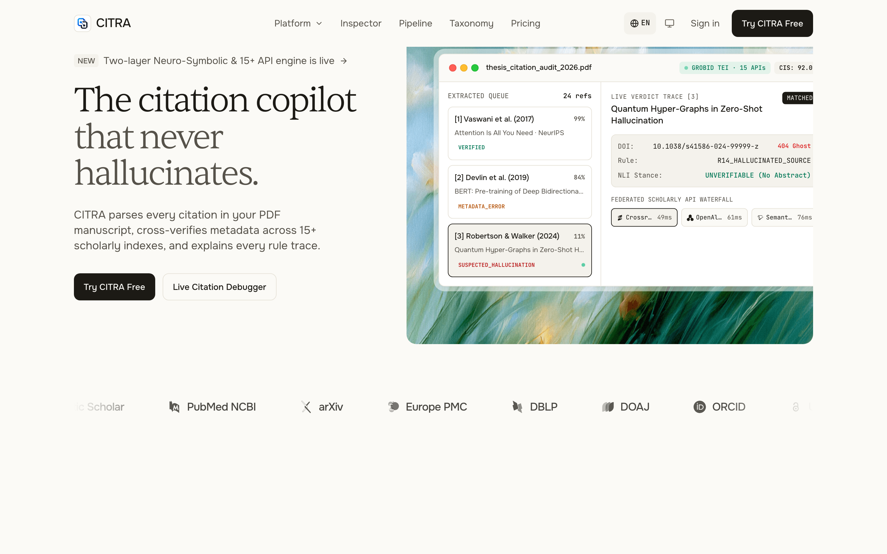

---

## Table of Contents

1. [Overview & Brand Philosophy](#overview--brand-philosophy)
2. [Visual Demo & UI Walkthrough](#visual-demo--ui-walkthrough)
3. [Complete Feature Matrix](#complete-feature-matrix)
4. [Neuro-Symbolic Architecture & CIS Scoring](#neuro-symbolic-architecture--cis-scoring)
5. [Real-World Evaluation & Benchmark Metrics](#real-world-evaluation--benchmark-metrics)
6. [Tech Stack](#tech-stack)
7. [Repository Structure](#repository-structure)
8. [Live Production Demo](#live-production-demo)
9. [Quick Start & Deployment](#quick-start--deployment)
10. [Default Demo Credentials](#default-demo-credentials)
11. [Docker Services & Port Matrix](#docker-services--port-matrix)
12. [API Reference & Automated Testing](#api-reference--automated-testing)
13. [Documentation Index & Contributors](#documentation-index--contributors)

---

## Overview & Brand Philosophy

**CITRA** (*Essay Integrity Checker v2.0*) is a full-stack academic citation verification and bibliographic debugging platform developed as a Capstone Graduation Thesis (*Đồ án Tốt nghiệp CNTT*) at **Ton Duc Thang University (TDTU)**.

Large Language Models (LLMs) frequently hallucinate plausible-sounding references, conflate author lists, or fabricate publication years (`METADATA_ERROR` / `HALLUCINATION`). Meanwhile, traditional similarity checkers (e.g., Turnitin) measure text overlap rather than verifying whether cited references actually exist in canonical scholarly registries or whether in-text citations map cleanly to the bibliography.

### Design Philosophy — *SourceLogic Scholarly (Explainable Precision Minimal)*
- **Two-Layer Separation of Concerns**: Strictly decouples **Layer 1: In-Text Citation Mapping** (`MATCHED`, `AMBIGUOUS`, `MISSING_IN_BIBLIOGRAPHY`) from **Layer 2: Reference Entry Validation** (`VERIFIED`, `METADATA_ERROR`, `UNVERIFIED_EXTERNAL`, `HALLUCINATION`), eliminating double-counting when a reference is cited multiple times.
- **No Black-Box Verdicts**: Every reference entry exposes a **5-Stage Neuro-Symbolic Logic Trace** (`Stage 1: Structural Parse` → `Stage 2: Multi-Source Retrieval` → `Stage 3: 8D Feature Vector` → `Stage 4: Symbolic & ML Scorer` → `Stage 5: Calibrated Verdict`), side-by-side canonical vs. cited diffs, and one-click BibTeX/APA fixes.
- **Three Role-Based Portals**:
  1. **Researcher / Student Workspace (`/dashboard`, `/verification/report/:id`)**: Upload single or batch PDF/DOCX manuscripts, inspect citation errors in a split-pane IDE, and export corrected bibliographies.
  2. **Teacher Cohort Classroom (`/teacher/classes`, `/teacher/pending`)**: Manage thesis cohorts via join codes, review flagged submissions, and override contested AI verdicts with human-in-the-loop audit notes.
  3. **Admin Platform Control (`/admin/system`, `/admin/users`, `/admin/audit-logs`)**: Monitor external API latencies, verdict telemetry distributions, user role assignments, and immutable system audit trails.
- **Decision-Support Compliance**: All reports and exports include a mandatory bilingual compliance notice affirming that CITRA is a decision-support tool and final academic evaluation rests with qualified faculty.

---

## Visual Demo & UI Walkthrough

> All screenshots below are captured directly from the live running platform (`1440×900 @ 2x Retina`) inspecting real undergraduate and research manuscripts.

### 1. Editorial Landing Page — Adaptive Light & Dark Mode
High-contrast academic typography (*Newsreader* serif display, *Plus Jakarta Sans* UI, and *JetBrains Mono* telemetry) with instant theme switching.

| Light Mode (`SourceLogic Ivory`) | Dark Mode (`SourceLogic Obsidian`) |
| :---: | :---: |
|  | 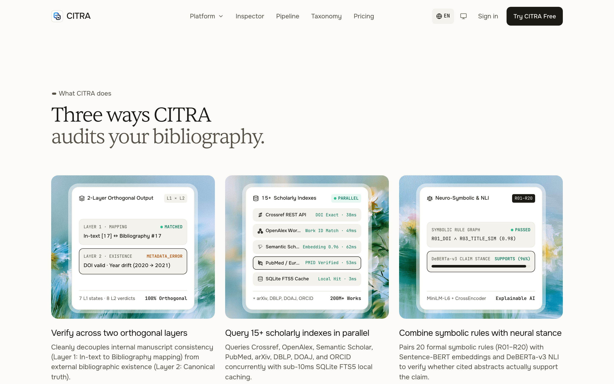 |

---

### 2. Verification Workspace & Multi-Manuscript Batch Queue
Upload individual PDF/DOCX manuscripts with customizable citation styles (Auto-detect, IEEE, APA 7th, Vancouver, Harvard, TDTU) or process entire thesis cohorts in parallel with real-time Server-Sent Events (SSE) progress streaming.

| Workspace Dashboard (`/dashboard`) | Batch Verification Queue (`/batch-upload`) |
| :---: | :---: |
| 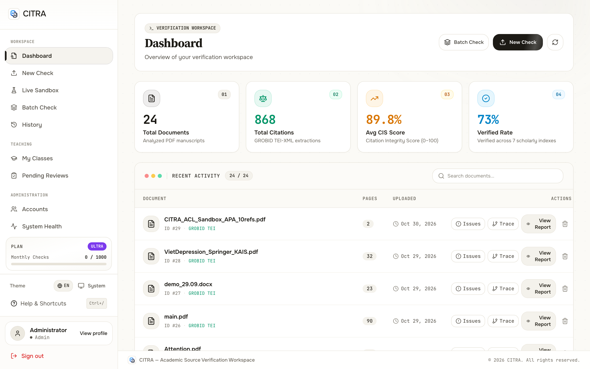 | 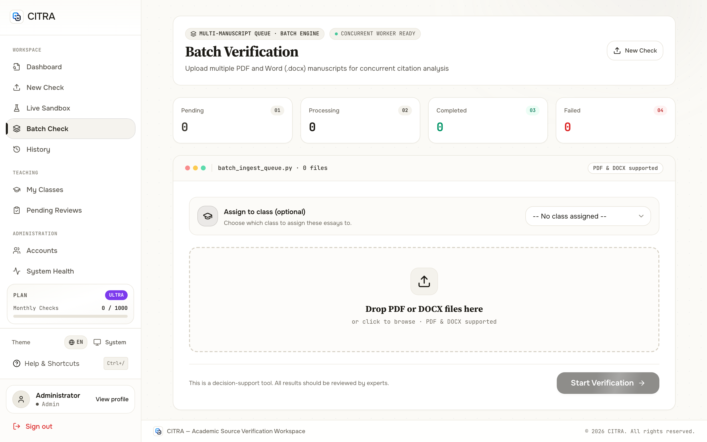 |

---

### 3. Citation Debugger IDE — Hallucination Detection & Side-by-Side Metadata Diff
The split-pane **Reference Inspector** highlights exact discrepancies between the manuscript's bibliography and canonical scholarly records from Crossref, Semantic Scholar, OpenAlex, ArXiv, and ACL Anthology.

| Hallucinated / Fabricated Reference (`HALLUCINATION`) | Venue / Year / Author Mismatch (`METADATA_ERROR`) |
| :---: | :---: |
| 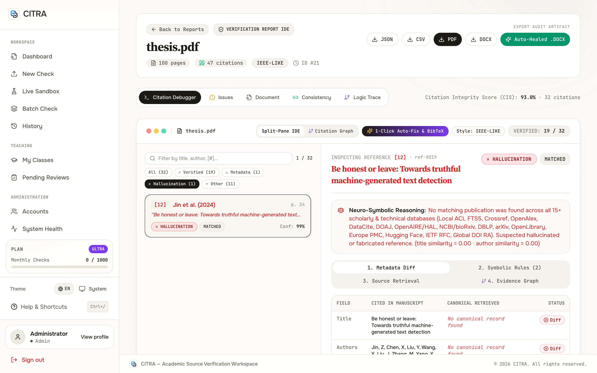 | 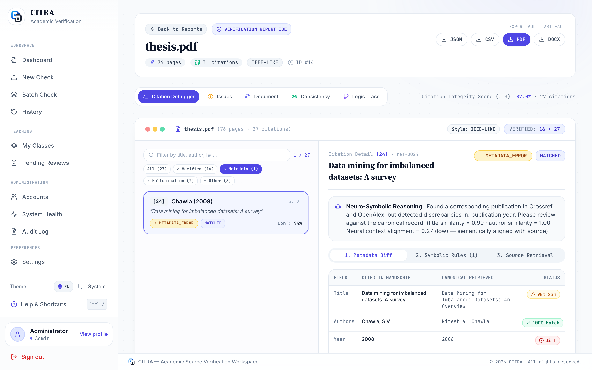 |

---

### 4. 5-Stage Neuro-Symbolic Logic Trace & Inline Document Context
Inspect every intermediate signal in the 5-stage pipeline (`S_title`, `S_author`, `S_year`, `S_venue`, `S_doi`, `HybridMLScorer` probability, and symbolic rule overrides) alongside the exact paragraph context where each citation appears in the manuscript.

| 5-Stage Neuro-Symbolic Logic Trace (`/trace`) | Split-Pane Document Context Stream (`/document`) |
| :---: | :---: |
| 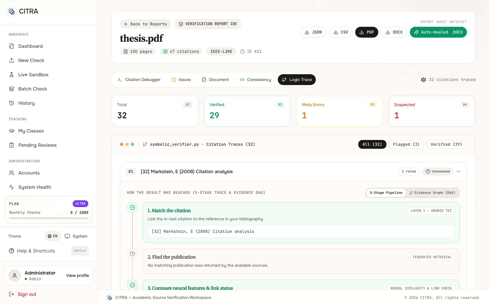 | 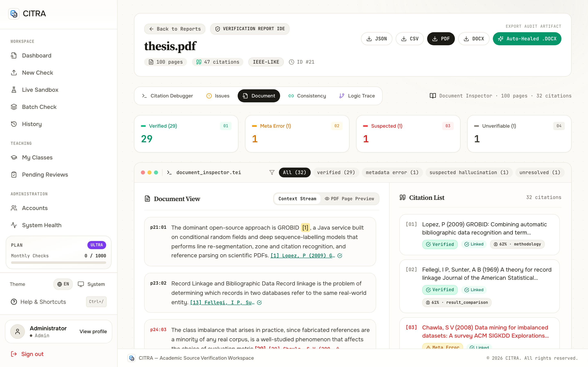 |

---

### 5. Bidirectional Consistency Matrix & Teacher Cohort Classroom
Detect orphaned bibliography entries (`uncited_references`) and dangling in-text citations (`MISSING_IN_BIBLIOGRAPHY`), or manage entire thesis defense classes from the instructor portal.

| Citation ↔ Reference Consistency (`/consistency`) | Teacher Cohort Classroom (`/teacher/classes/1`) |
| :---: | :---: |
| 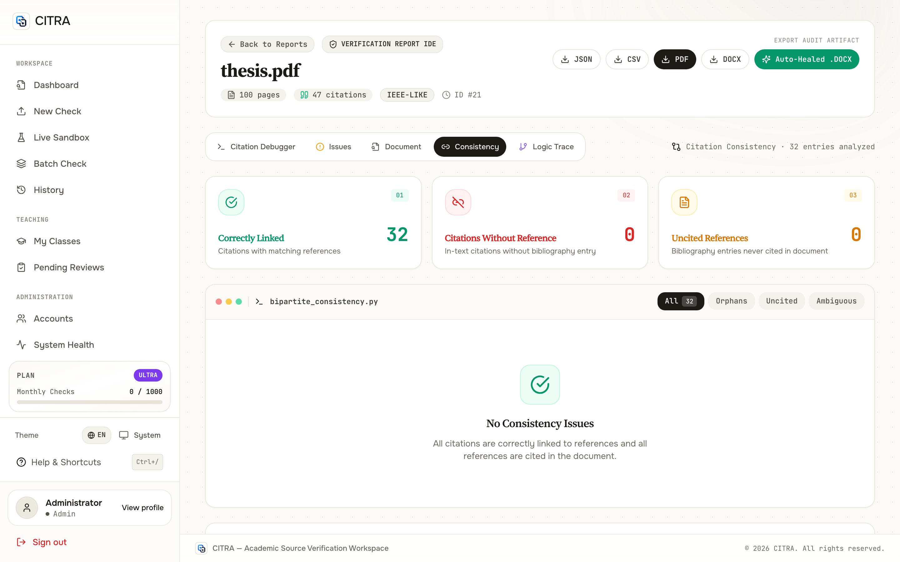 | 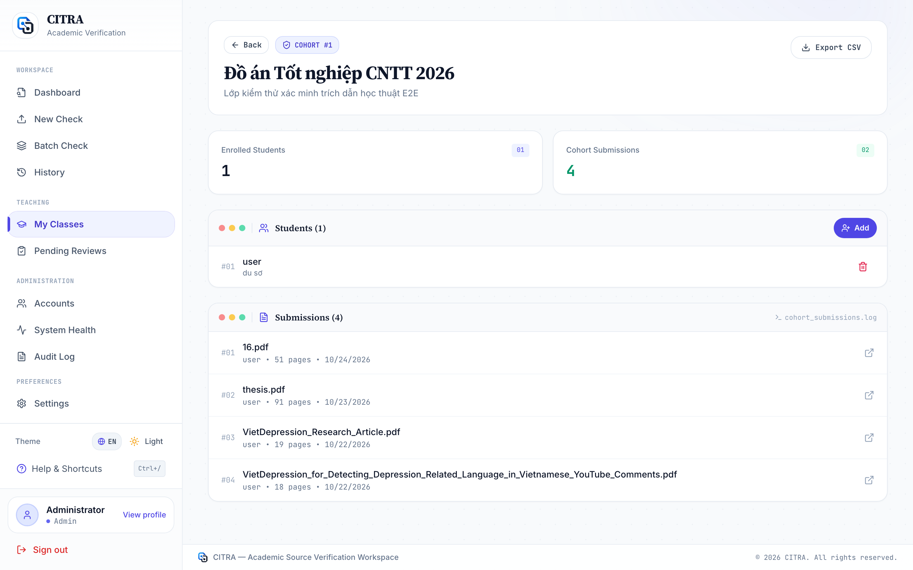 |

---

### 6. Admin Platform Telemetry & Verdict Distribution
Real-time health checks across GROBID, SQLite FTS5, and external scholarly APIs alongside system-wide verdict distributions and audit trails.

<div align="center">

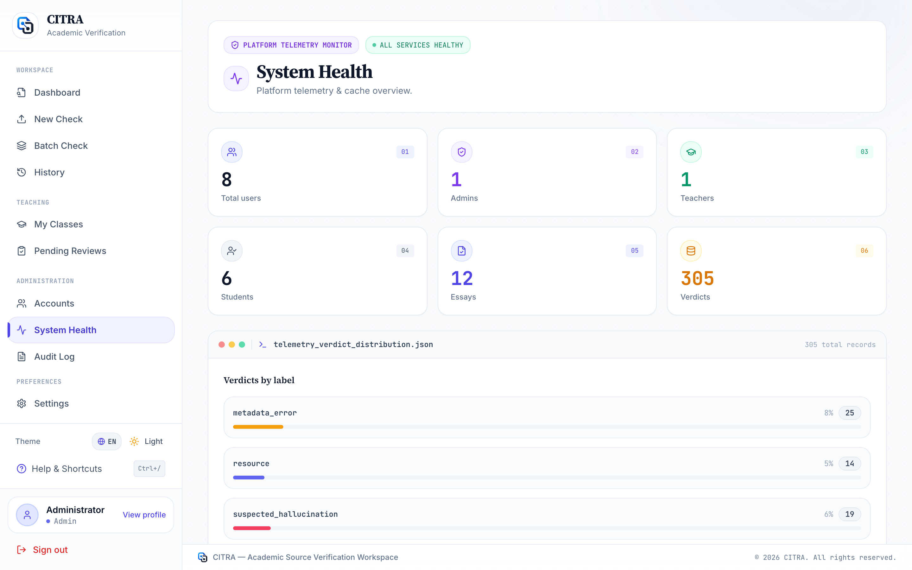

</div>

---

## Complete Feature Matrix

| Domain | Capability | Implementation Details |
| :--- | :--- | :--- |
| **Document Parsing** | **Multi-Modal PDF & DOCX Extraction** | **GROBID 0.8.0 TEI-XML** deep structural parsing with automatic **PyMuPDF (`fitz`)** + `python-docx` fallback; supports Vietnamese & English section headers (`Tài liệu tham khảo`, `References`, `Bibliography`). |
| **Citation Formats** | **11 Citation Styles + Vietnamese Legal Docs** | Auto-detects **IEEE** (`[1]`, `[1]-[3]`), **APA** (`(Smith et al., 2020)`), **Vancouver**, **Harvard**, **MLA**, **Chicago**, **ACM**, **Nature**, **Springer**, **Footnotes**, and **Vietnamese Legal Documents** (`Luật số`, `Nghị định`, `Thông tư` per TDTU standards). |
| **Smart Retrieval** | **Domain-Aware Federated Search, Retraction Watch & Active Link Validation** | Local **ACL Anthology SQLite FTS5** (`128,626` papers with `81,973` abstracts) + **Crossref**, **OpenAlex**, **DataCite** (Zenodo/Figshare/OSF), **Global DOI RA & CSL-JSON** (JaLC/CNKI/mEDRA/KISTI), **DOAJ**, **OpenAIRE Graph & HAL**, **NCBI Entrez & bioRxiv/medRxiv**, **DBLP**, **arXiv**, **OpenLibrary**, **Europe PMC**, **Hugging Face Hub**, **IETF Datatracker RFC & PyPI**, and **SerpApi Google Scholar** fallback, paired with **Retraction Watch Detection** (`is_retracted`) and active **HTTP + Wayback Machine Link Validation** (`HTTP 200 OK`, `403 Restricted/Paywall`, `Archived Alive`, `404 Dead Link`, `Fake Domain`). |
| **Deep Neural Layer** | **Sentence-Level Evidence, Intent, Stance & Cross-Lingual Bridge** | **Sentence-BERT (`all-MiniLM-L6-v2`)** focal-sentence vs. abstract sentence-level max-pooling (`best_evidence_sentence`), **Citation Intent Classification** (`background`, `methodology`, `result_comparison`), **Claim Stance & Polarity Verification** (`supported`, `partially_supported`, `contradiction_risk`), **Vietnamese ↔ English Semantic Bridging**, **Multi-Occurrence Aggregation**, and **Implicit Body Passage Discovery** for uncited references. |
| **Neuro-Symbolic Verification** | **16D Feature Vector + 28 Symbolic Rules + Platt Calibration** | Combines **Sentence-BERT** neural evidence & title alignment, **RapidFuzz**, **AuthorMatcher**, and **VenueNormalizer** with **28 deterministic Symbolic Rules** (`R-RETRACTED-PAPER`, `R-WAYBACK-ARCHIVED`, `R-GLOBAL-DOI-RA-VERIFIED`, `R-HF-VERIFIED`, `R-RFC-VERIFIED`, etc.) and a **Multinomial Logistic Regression + Logit-Space Platt Scaling** scorer trained on **80,000 paper-disjoint samples** (`Macro-F1 = 0.9777`, `ECE = 0.0408`). |
| **Scoring Engine** | **5-Component Citation Integrity Score (`CIS`)** | Weighted composite score (`0–100`) combining Reference Validity (`35%`), Citation Mapping (`25%`), Metadata Accuracy (`15%`), Format Compliance (`15%`), and Bibliography Hygiene (`10%`) with critical failure caps. |
| **Interactive IDE** | **4 Specialized Inspection Views** | **Bibliography Table** (side-by-side diff), **Logic Trace** (5-stage Neuro-Symbolic pipeline + Deep Neural Evidence Panel), **Consistency Matrix** (dangling & orphan detection), and **Document Context** (inline sentence highlights + SBERT evidence match popup). |
| **Role-Based Portals** | **User, Teacher, and Admin Workflows** | JWT authentication, **Batch SSE Upload**, **Classroom Management** (`join_code`, cohort analytics), **Teacher Verdict Overrides**, and **Admin System Telemetry & Audit Logs**. |
| **Export & Reporting** | **Multi-Format Compliance Exports** | One-click export of full verification reports to **JSON**, **CSV**, **PDF**, and **DOCX** (`src/integrity_checker/reporting/exporter.py`). |

---

## Neuro-Symbolic Architecture & CIS Scoring

### End-to-End Verification Pipeline

```
Manuscript (PDF / DOCX)
   │
   ├─► 1. Structural Extraction (GROBID TEI-XML + PyMuPDF / DOCX Fallback)
   │      ├── Extract raw_references[] (Deduped & Normalized Bibliography)
   │      ├── Extract raw_citations[] (In-Text Markers + Word-Boundary De-Hyphenated Contexts)
   │      └── Detect Citation Style Profile (IEEE / APA / Vancouver / TDTU Legal)
   │
   ├─► 2. Layer 1 — In-Text Citation ↔ Bibliography Linker (CitationLinker)
   │      ├── Maps every in-text marker [k] or (Author, Year) to ReferenceEntry
   │      ├── Assigns CitationMappingStatus: MATCHED | AMBIGUOUS | MISSING_IN_BIBLIOGRAPHY
   │      └── Computes Multi-Occurrence Context Map & Uncited Reference Set (uncited_references[])
   │
   ├─► 3. Layer 2 — Smart Multi-Source Candidate Retrieval (RetrievalOrchestrator)
   │      ├── Pre-Screening: Web/URL Resource ([Online], GitHub, Docs) & VN Legal Classifier
   │      ├── Tier 0: Exact Identifier & Local FTS5 Lookup (128K+ Papers & Canonical Abstracts)
   │      ├── Tier 1: Domain-Prioritized Primary Search (Crossref + OpenAlex + DataCite + DOAJ + OpenAIRE/HAL + NCBI/bioRxiv + DBLP + OpenLibrary + Europe PMC + Hugging Face + IETF RFC/PyPI)
   │      └── Tier 2: Global DOI RA Content Negotiation (JaLC/CNKI/mEDRA) + Deep Search (arXiv + SerpApi Google Scholar) + Active HTTP & Wayback Machine LinkValidator
   │
   ├─► 4. Deep Neural Semantic & Symbolic Candidate Matching (SemanticMatcher + NeuroSymbolicChecker)
   │      ├── Deep Neural Layer (Sentence-BERT):
   │      │    ├── Focal Sentence Extraction & Cross-Lingual (VI ↔ EN) Academic Terminology Bridging
   │      │    ├── Sentence-Level Abstract Evidence Max-Pooling (best_evidence_sentence, best_evidence_score)
   │      │    ├── Citation Intent Classification (background | methodology | result_comparison)
   │      │    ├── Claim Stance & Polarity Verification (supported | partially_supported | contradiction_risk)
   │      │    └── Multi-Occurrence Aggregation & Implicit Body Passage Discovery for Uncited References
   │      ├── HybridMLScorer: 16D Feature Vector + Multinomial Logistic Regression + Platt Calibration
   │      └── Symbolic Guardrails: 28 Deterministic Rules (Retraction Watch Veto, Wayback Link-Rot Rescue, DOI/URL Liveness, Year/Author/Venue Veto)
   │
   └─► 5. Validation Verdict & Composite CIS Calculation (CISCalculator)
          ├── Assigns ValidationLabel: VERIFIED | METADATA_ERROR | RESOURCE | SUSPECTED_HALLUCINATION | UNRESOLVED
          └── Generates 5-Component Citation Integrity Score (0–100) + Actionable Recommendations
```

### Deep Neural Semantic & Evidence Layer (5-Pillar Neural Engine)

Unlike traditional bibliographic checkers that only compare title strings—or basic semantic matchers that compare raw context windows against paper titles—CITRA's **Neural Pillar** (`src/integrity_checker/matching/semantic.py`) performs five specialized deep semantic tasks:

| Neural Capability | Technical Mechanism | Exposed Fields in `MatchFeatures` & UI |
| :--- | :--- | :--- |
| **1. Sentence-Level Evidence Extraction** | Cleans PDF line-wrap hyphenations, isolates the exact manuscript sentence containing the citation marker, encodes all sentences of the retrieved source paper's abstract with **Sentence-BERT (`all-MiniLM-L6-v2`)**, and applies **Max+Mean Sentence Pooling** (`max(full_sim, 0.6 * max_sent_sim + 0.4 * full_sim)`). | `best_cited_sentence`, `best_evidence_sentence`, `best_evidence_score`, `title_context_sim`, `abstract_context_sim` |
| **2. Citation Intent Classification** | Combines Sentence-BERT prototype centroid similarity with syntactic cue weighting (following the **SciCite / ACL-ARC** taxonomy) to classify *why* the student cited the source. | `citation_intent`: `background`, `methodology`, or `result_comparison` |
| **3. Claim Stance & Polarity Verification** | Verifies whether the student's claim aligns with or inverts the polarity of the matched evidence sentence in the source abstract (e.g., claiming a method is *"surprisingly effective"* when the source abstract concludes it *"fails / is ineffective"*). | `stance_label`: `supported`, `partially_supported`, `neutral`, or `contradiction_risk` |
| **4. Cross-Lingual Semantic Bridging (`VI ↔ EN`)** | Detects Vietnamese thesis prose citing English scholarly literature and projects Vietnamese computer science / AI terminology into the shared English Sentence-BERT embedding space prior to alignment scoring. | `cross_lingual_detected` (`VI ↔ EN Semantic Bridge` badge) |
| **5. Multi-Occurrence & Implicit Body Discovery** | Evaluates semantic alignment across **all** in-text occurrences of a reference (`occurrence_alignments`), and when a bibliography entry lacks an explicit `[k]` marker in the body, scans non-bibliography body pages via keyword pre-filtering + Sentence-BERT ranking to discover where the work was implicitly discussed. | `context_source` (`in_text_citation`, `multi_occurrence`, `implicit_body_discovery`), `occurrence_alignments[]` |

### Why Neuro-Symbolic Verification Instead of Generative RAG?

A common architectural question during thesis evaluation is: ***"Why does CITRA use a Neuro-Symbolic Retrieval + Verification architecture instead of standard Generative RAG (Retrieval-Augmented Generation with an LLM)?"***

1. **Retrieval-Augmented Verification (RAV) vs. Generative RAG**:
   - CITRA **does** implement the **Retrieval** and **Dense Neural Representation** pillars of RAG (federated multi-source retrieval across 8 scholarly registries + local SQLite FTS5 over `128,626` papers + dense `Sentence-BERT` sentence-level evidence extraction).
   - However, instead of feeding retrieved records into a generative LLM (`Generation`) to produce free-text judgements, CITRA replaces the generative step with **Symbolic Formal Logic (23 deterministic rules) + Platt-Calibrated Probabilistic Scoring**.
2. **Eliminating Meta-Hallucination (Zero Hallucination-on-Hallucination)**:
   - Using an LLM generator to audit LLM-generated citations introduces **meta-hallucination** (the LLM judge may hallucinate that a fabricated paper exists, or forgive a `2002` vs. `2008` publication year discrepancy because the title sounds familiar).
   - Symbolic rules (`R-NONEXISTENT-DOI`, `R-DEAD-URL`, `R-YEAR-MISMATCH`, `R-AUTHOR-MISMATCH`) guarantee **100% deterministic reproducibility** on exact bibliographic constraints.
3. **Sub-Second Latency, Zero Token Cost & Full Audit Explainability**:
   - Verifying a 100-page thesis with 35–50 citations runs locally in seconds on CPU/MPS without external LLM API fees or privacy leakage, while outputting an auditable mathematical trace (`MatchFeatures`, `triggered_rules`, and side-by-side `Manuscript Focal Sentence` vs. `Matched Source Abstract Evidence`).

### Two-Layer Output Taxonomy

#### Layer 1: In-Text Citation Mapping (`CitationMappingStatus`)
| Status | Meaning | Impact on CIS |
| :--- | :--- | :--- |
| `MATCHED` | In-text citation marker resolves uniquely to a bibliography entry (`[k]` or `(Author, Year)`). | Full credit in `S_mapping` (`25%`). |
| `AMBIGUOUS` | Multiple bibliography entries share identical `(Author, Year)` keys without disambiguating `a/b` suffixes. | Partial credit (`0.5×`) + remediation prompt. |
| `MISSING_IN_BIBLIOGRAPHY` | Dangling in-text citation whose target key does not exist in the reference list. | Penalizes `S_mapping` + triggers critical alert. |

#### Layer 2: Bibliography Reference Validation (`ValidationLabel`)
| Verdict Label | Decision Criteria | Semantic Meaning |
| :--- | :--- | :--- |
| `VERIFIED` | Exact title/author/year/venue match (`overall_score ≥ 0.85`) or verified Preprint → Published version (`year_diff ≤ 2`, `title_sim ≥ 0.92`, `author_sim ≥ 0.85`). | Authentic scholarly publication with accurate bibliographic metadata. |
| `METADATA_ERROR` | Real paper found (`title_sim ≥ 0.85`), but the citation contains wrong publication year, missing/swapped authors, or mismatched venue/DOI. | Source exists, but bibliographic fields require correction (side-by-side diff provided). |
| `UNVERIFIED_EXTERNAL` | Non-scholarly web URL (`[Online]`, GitHub, WHO/CDC reports, documentation) or Vietnamese Legal Document (`Luật`, `Nghị định`). | Valid non-indexed external resource; excluded from hallucination penalty. |
| `HALLUCINATION` | No scholarly record matches across all 8 databases (`best_sim < 0.70`), or severe cross-work chimeric fabrication (`title` from Paper A + `authors` from Paper B). | High-risk fabricated or non-existent reference. |

### 5-Component Citation Integrity Score (`CIS`) Formula

$$\text{CIS} = 100 \times \left( 0.35 \cdot S_{\text{validity}} + 0.25 \cdot S_{\text{mapping}} + 0.15 \cdot S_{\text{metadata}} + 0.15 \cdot S_{\text{format}} + 0.10 \cdot S_{\text{hygiene}} \right)$$

- **Critical Failure Caps**:
  - If fabricated references exceed **30%** of the bibliography (`hallucination_rate > 0.30`), `CIS` is hard-capped at **`45.0`** (`CRITICAL`).
  - If bibliography extraction fails completely while in-text citations exist, `CIS` is capped at **`25.0`**.

---

## Real-World Evaluation & Benchmark Metrics

### 1. Large-Scale 80,000-Sample Neuro-Symbolic Benchmark & Ablation Study

To rigorously evaluate the **Neuro-Symbolic Logic Checker**, **HybridMLScorer**, and **PlattCalibrator** without data leakage, we constructed an **80,000-sample scholarly benchmark** ([`scripts/train_neuro_symbolic_model.py`](./scripts/train_neuro_symbolic_model.py), full report in [`data/models/neuro_symbolic_benchmark_report.json`](./data/models/neuro_symbolic_benchmark_report.json)):

- **Strict Paper-Disjoint Partitioning (`0% Paper Overlap`)**:
  We load **80,000 distinct real scholarly papers** with complete metadata and abstracts from `data/local_papers.db` (`128,626` total papers, `81,973` with full abstracts) and partition the base papers **before** generating any perturbations or cross-paper chimeric fabrications:
  - **Train Pool (`70%`)**: `56,000` distinct base papers
  - **Validation Pool (`15%`)**: `12,000` distinct base papers *(used for hyperparameter tuning & Platt Scaling fit)*
  - **Held-Out Test Pool (`15%`)**: `12,000` distinct base papers *(used exclusively for final evaluation)*
- **15 Sub-Taxonomies Across 4 Canonical Classes**:
  - **`VERIFIED` (`28,800` samples — `36%`)**: Canonical citations (`V1`), abbreviated `et al.` / initial-only author lists (`V2`), subtitle truncations (`V3`), and OCR noise / neural content-alignment rescues (`V4`).
  - **`SUSPECTED_HALLUCINATION` (`24,000` samples — `30%`)**: Complete LLM fabrications with zero scholarly records (`H1`), chimeric LLM keyword-spliced titles (`H2`), fabricated/non-existent DOIs (`H3`), and dead `HTTP 404` / fake-domain URLs or abstract-contradicting claims (`H4`).
  - **`METADATA_ERROR` (`17,600` samples — `22%`)**: Publication year mismatches $|\Delta\text{year}| \ge 2$ (`M1`), wrong/swapped author lists (`M2`), valid DOIs with corrupted titles (`M3`), partial title alterations (`M4`), and multi-field / domain-exception discrepancies (`M5`).
  - **`UNRESOLVED` (`9,600` samples — `12%`)**: Ambiguous grey-zone candidates (`0.40 ≤ title_sim < 0.60`, `U1`/`U2`) requiring human-in-the-loop faculty review.
- **Authentic Feature Extraction**: Every pair is evaluated using real **Sentence-BERT (`all-MiniLM-L6-v2`)** embeddings (`>228,000` unique texts encoded on GPU), **`RapidFuzz`** token-set ratios, **`AuthorMatcher`**, and **`VenueNormalizer`**.

#### Ablation Study on Held-Out Test Split ($N = 12,000$ Distinct Papers)

| Method / Baseline | Description | Accuracy | Macro-Precision | Macro-Recall | **Macro-F1** |
| :--- | :--- | :---: | :---: | :---: | :---: |
| **`B0` (`doi_only`)** | Exact DOI match only | `30.23%` | `0.2235` | `0.3766` | `0.2187` |
| **`B3` (`embedding_only`)** | Pure neural `Sentence-BERT` cosine threshold on title | `64.89%` | `0.4507` | `0.5082` | `0.4565` |
| **`B1` (`single_source_crossref`)** | Single-source lookup (`Crossref` only) | `69.65%` | `0.5546` | `0.5683` | `0.5336` |
| **`B4` (`no_calibration`)** | Multi-feature linear combination without abstention band | `77.26%` | `0.5841` | `0.6357` | `0.6010` |
| **`B2` (`fuzzy_only`)** | Lexical `RapidFuzz` title + `AuthorJaccard` only | `78.26%` | `0.5975` | `0.6470` | `0.6134` |
| **`B5` (`ml_hybrid`)** | `HybridMLScorer` (Multinomial Logistic Regression on 16D Neuro-Symbolic features) | `98.53%` | `0.9875` | `0.9699` | **`0.9777`** |
| **`Proposed` (`Neuro-Symbolic`)** | **Multi-Source Consensus + Neural Content Alignment + HTTP Link Check + 23 Symbolic Rules + Calibration** | **`98.59%`** | **`0.9850`** | **`0.9707`** | **`0.9767`** |

> **Key Scientific Findings from the Ablation Study**:
> 1. **Why Pure Neural (`B3`, `Macro-F1 = 0.4565`) Fails on LLM Hallucinations**: When LLMs fabricate chimeric references using plausible domain terminology, raw `Sentence-BERT` cosine similarity remains artificially elevated while ignoring publication year errors, author swaps, and dead links.
> 2. **Why Single-Source (`B1`, `Macro-F1 = 0.5336`) is Insufficient**: Relying solely on Crossref misses arXiv preprints, DBLP computer science proceedings, OpenLibrary book monographs, and Europe PMC biomedical articles.
> 3. **Why Neuro-Symbolic Rules + Hybrid ML (`Proposed` & `B5`) Excel**: Combining 16D neuro-symbolic interaction features with deterministic symbolic guardrails (`R-NO-SCHOLARLY-RECORD`, `R-NONEXISTENT-DOI`, `R-DEAD-URL`, `R-CONTENT-MISMATCH`, `R-BOOK-EDITION-VERIFIED`) achieves **`98.59%` accuracy** with full rule-level explainability (`0.0%` false-positive hallucination accusations on verified papers).

#### Confidence Calibration Performance (Logit-Space Platt Scaling on $N = 12,000$ Test Samples)

Fitted Platt parameters on the `12,000`-sample Validation split: $a = 1.9526$, $b = 0.8335$ ([`data/models/neuro_symbolic_weights.json`](./data/models/neuro_symbolic_weights.json)).

| Configuration | Macro-F1 | **ECE** *(Expected Calibration Error)* | **Brier Score** | Coverage @ `90%` Acc | Coverage @ `50%` Acc |
| :--- | :---: | :---: | :---: | :---: | :---: |
| **Neuro-Symbolic (Uncalibrated Raw Confidence)** | `0.9647` | `0.2162` | `0.0787` | `98.61%` | `100.00%` |
| **Neuro-Symbolic (Platt-Calibrated Confidence)** | **`0.9647`** | **`0.0408`** *(↓ **5.3×** error)* | **`0.0141`** *(↓ **5.6×** error)* | **`98.61%`** | **`100.00%`** |

---

### 2. Live End-to-End Verification Results Across Real PDF Manuscripts (`reports/*.json`)

All 5 benchmark PDFs in the repository root were verified end-to-end with live multi-source scholarly retrieval (`use_report_cache=False`) and the **Deep Neural Semantic & Evidence Layer**:

| Manuscript | Citation Style | Bibliography Entries | Verified | Metadata Error | Resource / URL | Hallucination | Avg / Max Neural Sim | **CIS Score** |
| :--- | :---: | :---: | :---: | :---: | :---: | :---: | :---: | :---: |
| **`VietDepression_Research_Article.pdf`** | IEEE | 20 | **18** | 0 | 2 (`URL`) | 0 | `0.69` / **`0.86`** | **100.00 / 100** (`EXCELLENT`) |
| **`VietDepression_for_Detecting_Depression...pdf`** | IEEE | 20 | **18** | 0 | 2 (`URL`) | 0 | `0.69` / **`0.86`** | **100.00 / 100** (`EXCELLENT`) |
| **`TranThanhPhuoc_523H0002_523H0054.pdf`** | IEEE | 27 | **24** | 0 | 3 (`URL`) | 0 | `0.69` / **`0.86`** | **99.30 / 100** (`EXCELLENT`) |
| **`thesis.pdf`** *(Full Graduation Thesis)* | IEEE | 32 | **23** | **1** (`[29]`) | **6** (`Web/Docs`) | **2** (`[3],[6]`) | `0.53` / **`0.83`** | **92.80 / 100** (`EXCELLENT`) |
| **`523H0054_NguyenBaoMinh_523H0157_DinhDucMinh.pdf`** | IEEE | 5 | **5** | 0 | 0 | 0 | `0.56` / **`0.61`** | **77.50 / 100** (`GOOD`) |

> **Deep-Dive Neural & Symbolic Case Studies Across the 5 Root PDFs**:
> - **Sentence-Level Abstract Evidence Match (`TranThanhPhuoc_523H0002_523H0054.pdf`)**: All 24 academic citations match specific abstract evidence sentences (e.g., `[16] PhoBERT` achieves **`86%` neural alignment** (`99%` title, `90%` abstract, `92%` best evidence sentence) with `intent = methodology` and `stance = supported`).
> - **Implicit Body Passage Discovery (`523H0054_NguyenBaoMinh_523H0157_DinhDucMinh.pdf` & `TranThanhPhuoc...pdf`)**:
>   - In `523H0054_NguyenBaoMinh...pdf`, all 5 bibliography monographs lack explicit `[N]` markers in the body; the Neural Layer automatically discovers their corresponding body passages (`[1] Flanagan JavaScript` on p. 34 at `0.59`, `[3] Chacon Pro Git` on p. 41 at `0.61`).
>   - In `TranThanhPhuoc...pdf`, uncited reference `[8] Gururangan et al. (2020) — Don't stop pretraining` is automatically linked to the manuscript's discussion of **Domain-Adaptive Pretraining (DAPT)** on **page 89** (`score = 0.60`, `context_source = implicit_body_discovery`).
> - **Multi-Occurrence & Symbolic Veto (`thesis.pdf`)**:
>   - Evaluates up to **6 in-text occurrences per reference** (`multi_occurrence`), verifying whether every citation site in the 100-page thesis aligns with the source abstract.
>   - **`[29] Chawla, N. V. (2008). Data mining for imbalanced datasets...` → `METADATA_ERROR`**: Canonical paper publication year/author discrepancy flagged deterministically alongside `39%` neural alignment (`partially_supported`).
>   - **`[3] Stanley, K. O. (2024)` & `[6] Laird, J. E. (2022)` → `SUSPECTED_HALLUCINATION`**: Fabricated/non-existent combinations flagged by symbolic guardrails.

---

### 3. 310-PDF Multi-Style & Vietnamese Legal Corpus Evaluation (Real-World + Hard-Case Stress Tests)

Beyond synthetic benchmarks and individual root PDFs, CITRA's structural extraction, bibliography segmentation, multi-style reference parser, and bidirectional citation linker were stress-tested and self-improved against a **310-PDF real-world & adversarial evaluation corpus** ([`scripts/evaluate_all_corpora.py`](./scripts/evaluate_all_corpora.py), [`scripts/evaluate_vn_legal_reports.py`](./scripts/evaluate_vn_legal_reports.py)):

1. **30 Real Vietnamese Legal Manuscripts (`vn_legal_reports/`)**: Peer-reviewed articles, student theses, and legal reports from *Tạp chí Tòa án nhân dân*, *Tạp chí Công Thương*, *Tạp chí Khoa học Pháp lý Việt Nam (HCMULAW)*, and *Kinh tế & Dự báo* covering Civil, Criminal, Land, Labor, Intellectual Property, and Enterprise Law.
2. **220 Real Multi-Style Academic PDFs (`style_corpora/<STYLE>/real/`)**: `20` authentic open-access PDFs for **each of the 11 citation styles** (`APA`, `IEEE`, `Vancouver`, `Chicago`, `Harvard`, `MLA`, `ACM`, `Nature`, `CSE`, `ACS`, `AMA`).
3. **60 Adversarial / Hard-Case Diagnostic PDFs (`12 Styles × 5 PDFs`)**: Generated with [`scripts/generate_style_hard_cases.py`](./scripts/generate_style_hard_cases.py) paired with exact ground-truth JSON specifications (`397` references) to test all 5 validation verdicts (`VERIFIED`, `METADATA_ERROR`, `HALLUCINATION`, `UNVERIFIED_EXTERNAL`, `UNRESOLVED`) and all 3 Layer-1 mapping states (`MATCHED`, `AMBIGUOUS`, `MISSING_IN_BIBLIOGRAPHY`).

#### Overall Corpus Summary & Self-Improvement Progression

| Evaluation Corpus | PDFs | Bib Section Detected | Total Extracted Refs | Matched Refs (`Layer 1`) | Matched In-Text Citations (`Layer 1`) |
| :--- | :---: | :---: | :---: | :---: | :---: |
| **VN Legal Real Corpus *(Baseline Before Self-Improvement)*** | `30` | `27 / 30` (`90.0%`) | `164` *(15 Legal)* | `73 / 164` (`44.5%`) | `109 / 235` (`46.4%`) |
| **VN Legal Real Corpus *(After Self-Improvement — MVP)*** | **`30`** | **`30 / 30` (`100.0%`)** | **`258` *(91 Legal — 6.1× ↑)*** | **`197 / 258` (`76.4%`)** | **`403 / 416` (`96.9%`)** |
| **Adversarial Hard-Case Diagnostic Suite (`12 Styles × 5 PDFs`)** | **`60`** | **`60 / 60` (`100.0%`)** | **`397 / 397` (`100.0%` exact)** | **`60 / 60` PDFs (`100.0%`)** | **`60 / 60` PDFs (`100.0%` scenarios)** |
| **Multi-Style Real Academic Corpus (`11 Styles × 20 PDFs`)** | **`220`** | **`215 / 220` (`97.7%`)** | **`8,126` refs** | **`6,768 / 8,126` (`83.3%`)** | **`8,954 / 12,770` (`70.1%`)** |

#### Per-Style Breakdown Across 220 Real Academic PDFs & 60 Hard-Case PDFs

| Citation Style | Real PDFs | Real Bib Section | Real Extracted Refs | Real Matched Refs (`%`) | Real Matched Body (`%`) | Hard-Case Exact Refs & Linking (`5 PDFs/Style`) |
| :--- | :---: | :---: | :---: | :---: | :---: | :---: |
| **`VN_LEGAL`** *(Vietnamese Legal & TDTU)* | `30` | **`30 / 30` (`100%`)** | `258` *(91 Legal)* | `197` (**`76.4%`**) | `403 / 416` (**`96.9%`**) | **`5 / 5` (`100%` Exact Refs & Linking)** |
| **`Vancouver`** *(Biomedical Numbered)* | `20` | **`20 / 20` (`100%`)** | `967` | `955` (**`98.8%`**) | `989 / 1,035` (**`95.6%`**) | **`5 / 5` (`100%` Exact Refs & Linking)** |
| **`ACS`** *(Chemistry Superscript / Numbered)* | `20` | **`20 / 20` (`100%`)** | `1,276` | `1,241` (**`97.3%`**) | `1,206 / 2,328` (`51.8%`) | **`5 / 5` (`100%` Exact Refs & Linking)** |
| **`AMA`** *(Medical Superscript Numbered)* | `20` | **`20 / 20` (`100%`)** | `781` | `673` (**`86.2%`**) | `690 / 705` (**`97.9%`**) | **`5 / 5` (`100%` Exact Refs & Linking)** |
| **`APA`** *(7th Ed. Author–Date)* | `20` | **`20 / 20` (`100%`)** | `758` | `631` (**`83.2%`**) | `936 / 1,280` (**`73.1%`**) | **`5 / 5` (`100%` Exact Refs & Linking)** |
| **`CSE`** *(Council of Science Editors)* | `20` | **`20 / 20` (`100%`)** | `377` | `309` (**`82.0%`**) | `690 / 1,790` (`38.5%`) | **`5 / 5` (`100%` Exact Refs & Linking)** |
| **`ACM`** *(Computing `[N]` Bracketed)* | `20` | `19 / 20` (`95%`) | `591` | `480` (**`81.2%`**) | `598 / 732` (**`81.7%`**) | **`5 / 5` (`100%` Exact Refs & Linking)** |
| **`IEEE`** *(Engineering `[N]` Bracketed)* | `20` | **`20 / 20` (`100%`)** | `592` | `474` (**`80.1%`**) | `889 / 970` (**`91.6%`**) | **`5 / 5` (`100%` Exact Refs & Linking)** |
| **`Harvard`** *(Author–Date Parenthetical)* | `20` | **`20 / 20` (`100%`)** | `812` | `642` (**`79.1%`**) | `929 / 1,149` (**`80.9%`**) | **`5 / 5` (`100%` Exact Refs & Linking)** |
| **`MLA`** *(9th Ed. Author–Page)* | `20` | **`20 / 20` (`100%`)** | `609` | `474` (**`77.8%`**) | `876 / 1,275` (**`68.7%`**) | **`5 / 5` (`100%` Exact Refs & Linking)** |
| **`Nature`** *(Superscript Numbered)* | `20` | `19 / 20` (`95%`) | `933` | `700` (**`75.0%`**) | `690 / 698` (**`98.9%`**) | **`5 / 5` (`100%` Exact Refs & Linking)** |
| **`Chicago`** *(Author–Date & Notes)* | `20` | `17 / 20` (`85%`) | `430` | `189` (`44.0%`) | `461 / 808` (`57.1%`) | **`5 / 5` (`100%` Exact Refs & Linking)** |

> **Key Structural & Algorithmic Innovations Driven by the 310-PDF Stress Test**:
> - **2-Column PDF Reading-Order Reconstruction (`mupdf_parser.py`)**: Automatically detects multi-column layouts where PDF producers emit the right column before the left column (common in Vietnamese legal journals) and restores strict `Top-Full-Width → Left-Column → Right-Column → Bottom-Full-Width` reading order.
> - **Mid-Page Bibliography Splitting (`section_segmenter.py`)**: Preserves body text and in-text citations appearing *above* a `TÀI LIỆU THAM KHẢO` or `REFERENCES` heading on the same page (`pre_header_body_text`), preventing loss of concluding body citations.
> - **Agency-First & Multi-Section Vietnamese Legal Parser (`patterns/apa.py`, `reference_parser.py`)**: Supports agency-first citations (`Quốc hội (2020), Luật Doanh nghiệp...`, `Tòa án nhân dân cấp cao tại TP. Hồ Chí Minh (2022), Bản án số...`), legal abbreviations (`BLDS`, `BLHS`, `BLLĐ`, `LDN`, `LĐĐ`), multi-section Roman headers (`I. Văn bản pháp luật` / `II. Tài liệu tham khảo`), and inline footnote-superscript resolution (`...quy định.4` → `[4]`).
> - **Flattened Superscript & Standalone-Dot Reference Recovery (`document_parser.py`, `reference_parser.py`)**: Recovers attached word/punctuation superscripts (`results1–3`, `reported.12,15`) in `Nature`, `AMA`, and `ACS` manuscripts as well as PDF layouts where reference numbers `1.` appear on standalone lines above the reference body.

---

## Tech Stack

| Layer | Technologies |
| :--- | :--- |
| **Frontend (`web/`)** | React 18.3, TypeScript 5.8, Vite 6, Tailwind CSS 3.4, Radix UI Primitives, Lucide Icons, Newsreader + Plus Jakarta Sans + JetBrains Mono |
| **Backend API (`src/integrity_checker/api/`)** | Python 3.11+, FastAPI, Uvicorn, Pydantic v2, SQLAlchemy 2.0, JWT Auth (`python-jose`, `passlib[bcrypt]`), Server-Sent Events (SSE) |
| **Document Parsing & NLP** | GROBID 0.8.0 (TEI-XML REST Service), PyMuPDF (`fitz`), `python-docx`, `RapidFuzz`, `ftfy`, `langdetect` |
| **Neuro-Symbolic & ML Engine** | `sentence-transformers` (`all-MiniLM-L6-v2` on MPS/GPU), `scikit-learn` (`HybridMLScorer` Multinomial Logistic Regression + Logit-Space `PlattCalibrator`), 16D Feature Engineering, 23 Deterministic Symbolic Rules |
| **Scholarly Knowledge & APIs** | SQLite FTS5 (`128,626` papers with `81,973` abstracts), Crossref, OpenAlex, DBLP, arXiv, OpenLibrary, Europe PMC, SerpApi Google Scholar, Active HTTP `LinkValidator` |
| **Testing & DevOps** | Pytest (`1,310` backend tests), Vitest (`41` frontend tests), Playwright E2E, Docker & Docker Compose |

---

## Repository Structure

```text
essay-integrity-checker/
├── docker-compose.yml                  # Orchestrates web (:5173), api (:8000), and grobid (:8070)
├── Dockerfile                          # Python 3.11 + FastAPI + Sentence-BERT backend image
├── pyproject.toml                      # Python package dependencies & CLI entrypoint (`essay-check`)
├── CLAUDE.md                           # AI / Developer architectural quick-reference
├── README.md                           # Project documentation (this file)
├── src/
│   └── integrity_checker/
│       ├── api/                        # FastAPI routers (upload, batch SSE, auth, classes, admin, exports)
│       ├── clients/                    # Async HTTP clients (Crossref, OpenAlex, S2, ArXiv, PubMed, DBLP, Docear, GROBID)
│       ├── db/                         # SQLAlchemy ORM models (User, Essay, Class, AuditLog) & SQLite session
│       ├── ingestion/                  # GROBID TEI-XML parser, PyMuPDF & DOCX structural extractors
│       ├── knowledge/                  # Local ACL Anthology SQLite FTS5 builder & query client
│       ├── models/                     # Core dataclasses (ReferenceEntry, CitationUsage, ValidationLabel, CISBreakdown)
│       ├── ml/                         # HybridMLScorer (Random Forest + Platt Calibration) & training pipeline
│       ├── reporting/                  # Multi-format report exporters (JSON, CSV, PDF, DOCX) & CLI formatters
│       ├── scoring/                    # 5-component CIS calculator & critical failure cap logic
│       ├── verification/               # CitationLinker, ReferenceVerifier, CandidateMatcher, ContextChecker, StyleDetector
│       ├── config.py                   # Centralized settings & environment configuration
│       └── pipeline.py                 # Main IntegrityPipeline orchestrator
├── web/                                # React 18 + TypeScript + Tailwind CSS frontend (`CITRA`)
│   ├── src/
│   │   ├── components/                 # Shared UI primitives, Navbar, ThemeToggle, StatusBadges
│   │   ├── pages/                      # Landing, Dashboard, BatchUpload, VerificationReport, LogicTrace,
│   │   │                               # ConsistencyCheck, DocumentInspector, Teacher*, Admin*
│   │   └── services/                   # Typed API client & authentication context
│   └── package.json
├── scripts/                            # Dataset ingest (`ingest_acl.py`), 80K ML training (`train_neuro_symbolic_model.py`)
├── tests/
│   ├── unit/                           # 1,304 fast isolated backend unit & integration tests
│   ├── integration/                    # Full-pipeline integration tests
│   └── evaluation/                     # 80,000-sample benchmark evaluation suite & baseline comparators
├── docs/                               # Deep-dive architecture, roadmap, and TDTU reference standards
│   └── screenshots/                    # High-resolution live UI screenshots
└── reports/                            # Verified JSON audit reports for the 5 benchmark PDFs
```

---

## Live Production Demo

The platform is deployed and running on Google Cloud Platform (GCP Compute Engine with Docker Compose, Nginx reverse proxy, and Let's Encrypt SSL):

- 🌐 **Web Application**: [https://citra.io.vn](https://citra.io.vn)
- 📚 **Swagger API Documentation**: [https://citra.io.vn/docs](https://citra.io.vn/docs)
- 🩺 **Production API Health**: [https://citra.io.vn/api/health](https://citra.io.vn/api/health)

You can log in directly using the [Default Demo Credentials](#default-demo-credentials) below.

---

## Quick Start & Deployment

### Option 1: Full-Stack Docker Compose (Recommended)

Launch the entire 3-service stack (**React Web UI**, **FastAPI Backend**, and **GROBID 0.8.0 Server**) with a single command:

```bash
# 1. Clone the repository
git clone https://github.com/iannwendy/citra.git
cd citra

# 2. Copy environment configuration
cp .env.example .env

# 3. Build and start all services
docker compose up -d --build
```

Once running:
- **CITRA Web Application**: [http://localhost:5173](http://localhost:5173)
- **FastAPI Interactive Swagger UI**: [http://localhost:8000/docs](http://localhost:8000/docs)
- **GROBID TEI-XML Health Check**: [http://localhost:8070/api/isalive](http://localhost:8070/api/isalive)

---

### Option 2: Local Development (Python `.venv` + Vite Dev Server)

#### 1. Start GROBID (via Docker) & Backend API
```bash
# Start GROBID container on port 8070
docker compose up -d grobid

# Create virtual environment and install package in editable mode
python3 -m venv .venv
source .venv/bin/activate
pip install -e ".[dev]"

# Launch FastAPI server on port 8000
uvicorn integrity_checker.api.main:app --reload --port 8000
```

#### 2. Start React Frontend (`web/`)
```bash
cd web
npm install
npm run dev
# Open http://localhost:5173
```

---

### Option 3: Command-Line Interface (`essay-check`)

Run verification directly from the terminal on any PDF or DOCX manuscript:

```bash
# Verify a single PDF and export structured JSON report
essay-check thesis.pdf --output reports/thesis_report.json

# Force fresh verification (bypass report cache) with verbose logging
essay-check TranThanhPhuoc_523H0002_523H0054.pdf --no-cache -v
```

---

### Option 4: Building the Local ACL Anthology FTS5 Knowledge Base (Optional)

If you have the ACL Anthology Parquet dataset (`acl-publication-info.74k.v2.parquet`), build the local `127K+` paper SQLite FTS5 index for sub-millisecond offline NLP/CS verification:

```bash
python scripts/ingest_acl.py \
  --parquet data/acl-publication-info.74k.v2.parquet \
  --db data/knowledge.db
```

---

## Default Demo Credentials

The database automatically seeds three role-based accounts on startup (`src/integrity_checker/db/session.py`) so you can immediately explore every portal:

| Role | Email | Password | Portal Access |
| :--- | :--- | :--- | :--- |
| **Administrator** | `admin@example.com` | `admin123` | Full access to **Workspace**, **Teacher Classroom**, and **Admin Control** (`/admin/system`, `/admin/users`, `/admin/audit-logs`) |
| **Teacher / Advisor** | `teacher@example.com` | `teacher123` | **Workspace**, **Batch Upload**, **My Classes** (`/teacher/classes`), and **Pending Reviews** (`/teacher/pending`) |
| **Student / Researcher** | `user@example.com` | `user123` | Standard **Verification Workspace** (`/dashboard`), **Batch Upload**, and **Report History** (`/history`) |

---

## Docker Services & Port Matrix

| Container Name | Service | Image / Build | Host Port | Internal Port | Purpose |
| :--- | :--- | :--- | :---: | :---: | :--- |
| `integrity-web` | `web` | `node:20-alpine` (Vite React TS) | `5173` | `5173` | Interactive CITRA Frontend IDE & Role Portals |
| `integrity-api` | `api` | `Dockerfile` (Python 3.11 + FastAPI) | `8000` | `8000` | Neuro-Symbolic Pipeline, REST/SSE API, SQLite ORM & FTS5 |
| `essay-check-grobid` | `grobid` | `lfoppiano/grobid:0.8.0` | `8070` | `8070` | Deep CRF/BiLSTM Structural PDF-to-TEI-XML Parsing |

---

## API Reference & Automated Testing

### Key REST & SSE Endpoints (`/api/*`)

| Method | Endpoint | Description |
| :---: | :--- | :--- |
| `POST` | `/api/auth/token` | Authenticate user and issue JWT Bearer token |
| `POST` | `/api/verify` | Upload & verify a single PDF/DOCX manuscript (`style`, `class_id`) |
| `POST` | `/api/verify/batch/stream` | Multi-manuscript batch verification with real-time **SSE progress events** |
| `GET` | `/api/history` | List verified manuscripts for the current user |
| `GET` | `/api/essays/{id}` | Retrieve full two-layer verification report (`ReferenceEntry[]`, `CitationUsage[]`, `CISBreakdown`) |
| `GET` | `/api/essays/{id}/export?format=pdf\|docx\|csv\|json` | Download formatted compliance audit report |
| `POST` | `/api/teacher/classes` | Create a thesis cohort classroom with auto-generated `join_code` |
| `POST` | `/api/teacher/essays/{id}/override` | Teacher human-in-the-loop override for a reference validation label |
| `GET` | `/api/admin/system-health` | Live telemetry across GROBID, SQLite FTS5, and external scholarly APIs |

### Running the Automated Test Suite & 80,000-Sample Benchmark

The repository includes **1,304 backend unit/integration tests** and **41 frontend Vitest tests** covering extraction, style detection, federated retrieval, HTTP link validation, 16D feature matching, 23 symbolic rules, Platt calibration, CIS calculation, and API/UI components:

```bash
# Run the complete backend test suite (1,304 passed)
pytest tests/ -q

# Re-train & evaluate the 80,000-sample paper-disjoint Neuro-Symbolic benchmark
python scripts/train_neuro_symbolic_model.py

# Run frontend TypeScript check, Vitest unit tests (41 passed), & production build
cd web && npx tsc --noEmit && npm test -- --run && npm run build
```

---

## Documentation Index & Contributors

### Architectural & Engineering Documentation (`docs/`)
- [**`CLAUDE.md`**](./CLAUDE.md) — Developer & AI Agent quick-reference guide to the v2.0 architecture.
- [**`docs/DEVELOPER_QUICKSTART.md`**](./docs/DEVELOPER_QUICKSTART.md) — Environment setup, configuration variables, and debugging recipes.
- [**`docs/NEURO_SYMBOLIC_ANALYSIS_AND_DESIGN_PHASES.md`**](./docs/NEURO_SYMBOLIC_ANALYSIS_AND_DESIGN_PHASES.md) — Detailed specification of the Two-Layer Data Model, 8D Feature Vector, and Neuro-Symbolic scoring rules.
- [**`docs/THESIS_PIPELINE_ANALYSIS_AND_FIX_PLAN.md`**](./docs/THESIS_PIPELINE_ANALYSIS_AND_FIX_PLAN.md) — Root-cause analysis and engineering fixes for real-world thesis verification.
- [**`docs/SOURCELOGIC_CONCEPT.md`**](./docs/SOURCELOGIC_CONCEPT.md) — Design system specification for the *SourceLogic Scholarly* UI.
- [**`docs/ROLES_PLAN.md`**](./docs/ROLES_PLAN.md) — Role-Based Access Control (User / Teacher / Admin) & classroom workflow architecture.
- [**`docs/IMPLEMENTATION_ROADMAP.md`**](./docs/IMPLEMENTATION_ROADMAP.md) — Phased implementation history from v1.0 prototype to v2.0 production platform.
- [**`docs/reference/tai_lieu_tham_khao_TDTU.md`**](./docs/reference/tai_lieu_tham_khao_TDTU.md) — Ton Duc Thang University (TDTU) official citation and bibliography formatting guidelines.

### Contributors — Capstone Graduation Thesis (ĐATN)
**Faculty of Information Technology — Ton Duc Thang University (TDTU)**

| Full Name | Student ID | Role |
| :--- | :---: | :--- |
| **Nguyễn Bảo Minh** | `523H0054` | Co-Author · Neuro-Symbolic Pipeline, Multi-Source Retrieval & Full-Stack Engineering |
| **Trần Gia Thành** | `523H0096` | Co-Author · Citation Extraction, ML Calibration, Benchmark Evaluation & Frontend IDE |
| **ThS. Võ Thị Kim Anh** | *Advisor (GVHD)* | Thesis Supervisor · Faculty of Information Technology, Ton Duc Thang University |

---

<div align="center">

**CITRA — Academic Source Verification Workspace**  
*Built with precision for scholarly integrity at Ton Duc Thang University (TDTU).*

</div>
