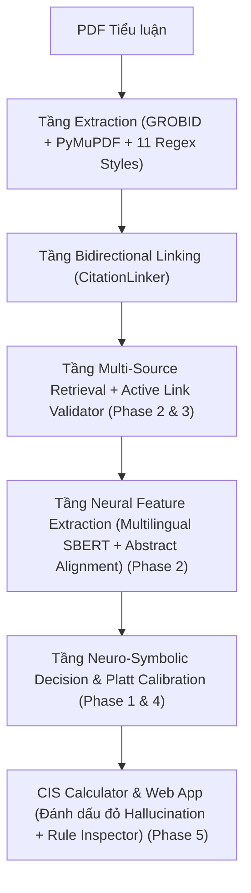

# Phân Tích Đề Tài & Kế Hoạch Thiết Kế Nâng Cấp Hệ Thống Neuro-Symbolic Logic Checker

> **Ngày lập tài liệu:** 2026-10-24  
> **Dự án:** Essay Integrity Checker (`v1.12`)  
> **Mục tiêu:** Đối chiếu toàn diện codebase với đề cương khóa luận, đánh giá kiến trúc **Neuro-Symbolic Logic Checker**, và phân chia lộ trình cải tiến theo từng **Phase thiết kế (Design Phases)**.

---

## QUY TẮC TRIỂN KHAI BẮT BUỘC (MANDATORY ENGINEERING RULES)

1. **Kiểm thử nghiêm ngặt & Commit sau mỗi Task/Phase:**
   - Sau mỗi task hoàn thành, bắt buộc phải chạy bộ test (`pytest`) kỹ lưỡng.
   - Nếu có bất kỳ test nào fail, phải **dò xét kỹ nguyên nhân gốc rễ dựa trên luồng thực tế (production flow)** của hệ thống hiện tại rồi mới quyết định hướng fix chuẩn xác — **tuyệt đối không sửa bừa (hack/bypass)** chỉ để làm xanh test.
   - Sau khi toàn bộ test liên quan và regression suite pass 100%, thực hiện `git commit` rõ ràng cho từng Phase/Task.
2. **Thứ tự ưu tiên Ngôn ngữ (English-First, Vietnamese-Secondary):**
   - Toàn bộ hệ thống (mô hình embedding mặc định, tập quy tắc suy diễn, thông điệp `reasoning`, nhãn giao diện, tài liệu) **bắt buộc ưu tiên Tiếng Anh (English) lên hàng đầu**, sau đó mới hỗ trợ Tiếng Việt (Vietnamese) như một tính năng bổ trợ. Không đưa Tiếng Việt đè lên hoặc làm giảm chất lượng xử lý Tiếng Anh.
3. **Điểm dừng Xin ý kiến trước khi Huấn luyện Mô hình (Phase 4 Gate):**
   - Khi triển khai đến bước huấn luyện mô hình / tối ưu trọng số học máy (`Phase 4: Hybrid ML Scorer & Platt Calibration`), **bắt buộc dừng lại và đặt câu hỏi** cho người dùng về chiến lược dữ liệu, hàm mục tiêu và kiến trúc mô hình để chốt quyết định trước khi code.

---

## MỤC LỤC

1. [Phần 1: Phân tích Đề tài & Đối chiếu với Codebase hiện tại](#phần-1-phân-tích-đề-tài--đối-chiếu-với-codebase-hiện-tại)
2. [Phần 2: Đánh giá chuyên sâu Neuro-Symbolic Logic Checker](#phần-2-đánh-giá-chuyên-sâu-neuro-symbolic-logic-checker)
3. [Phần 3: Phân tích tầng "Neuro" — Hiện trạng & Điểm nghẽn](#phần-3-phân-tích-tầng-neuro--hiện-trạng--điểm-nghẽn)
4. [Phần 4: Lộ trình Thiết kế Nâng cấp theo từng Phase (Design Phases)](#phần-4-lộ-trình-thiết-kế-nâng-cấp-theo-từng-phase-design-phases)
   - [Phase 1: Tái cấu trúc Symbolic Decision Tree & Khôi phục khả năng phát hiện Hallucination](#phase-1-tái-cấu-trúc-symbolic-decision-tree--khôi-phục-khả-năng-phát-hiện-hallucination)
   - [Phase 2: Kích hoạt toàn diện tầng Neural Content Alignment (Abstract Pipeline & Cross-Lingual)](#phase-2-kích-hoạt-toàn-diện-tầng-neural-content-alignment-abstract-pipeline--cross-lingual)
   - [Phase 3: Thiết kế mô-đun Kiểm tra Liên kết Trực tuyến (Active Link & Identifier Validation)](#phase-3-thiết-kế-mô-đun-kiểm-tra-liên-kết-trực-tuyến-active-link--identifier-validation)
   - [Phase 4: Học kết hợp Neuro-Symbolic & Hiệu chỉnh Độ tin cậy (Hybrid ML Scorer & Platt Calibration)](#phase-4-học-kết-hợp-neuro-symbolic--hiệu-chỉnh-độ-tin-cậy-hybrid-ml-scorer--platt-calibration)
   - [Phase 5: Thực nghiệm Đối sánh, Đo lường & Đồng bộ Giao diện Web App](#phase-5-thực-nghiệm-đối-sánh-đo-lường--đồng-bộ-giao-diện-web-app)

---

## PHẦN 1: Phân tích Đề tài & Đối chiếu với Codebase hiện tại

### 1.1. Nội dung Đề tài đăng ký

* **Phương pháp luận:** Hệ thống Neuro-Symbolic Logic Checker kết hợp so khớp chuỗi văn bản nâng cao và kiểm tra liên kết (Link validation).
* **Dữ liệu:** Tập tài liệu tiểu luận mẫu (đã được ẩn danh) và cơ sở dữ liệu các bài báo khoa học mở (arXiv, Google Scholar API).
* **Công nghệ/AI:** Python, Regular Expressions nâng cao, NLP text similarity, API tích hợp.
* **Tiêu chí:**
  1. Xây dựng bộ quy tắc logic để bóc tách citation.
  2. Đo lường tỷ lệ phát hiện chính xác nguồn tài liệu giả mạo.
  3. Demo phần mềm (Web App) cho phép Giảng viên tải lên file PDF tiểu luận, hệ thống sẽ quét các tài liệu tham khảo và đánh dấu đỏ những nguồn tài liệu không có thật hoặc bị AI bịa ra.

### 1.2. Bảng đối chiếu 4 trụ cột Đề tài vs. Codebase (`v1.12`)

**Đánh giá tổng quan:** Hệ thống hiện tại **đang đi đúng hướng ~90–95%**, với kiến trúc phần mềm rất bài bản (FastAPI async, GROBID TEI XML + PyMuPDF, 11 chuẩn trích dẫn, Bidirectional Linking 2 chiều, SQLite FTS5 256MB, giao diện React/TypeScript đầy đủ).

| Trụ cột đề tài | Hiện trạng trong Codebase | Đánh giá & Lưu ý |
| :--- | :--- | :--- |
| **1. Phương pháp luận** *(Neuro-Symbolic Logic Checker + So khớp chuỗi nâng cao + Link validation)* | - **Neuro-Symbolic:** Đã triển khai tại [`NeuroSymbolicChecker`](file:///Users/iannwendy/Desktop/DATN/essay-integrity-checker/src/integrity_checker/logic/neuro_symbolic_checker.py#L31-L424) kết hợp vector đặc trưng từ [`FeatureCalculator`](file:///Users/iannwendy/Desktop/DATN/essay-integrity-checker/src/integrity_checker/matching/features.py#L19-L268) và tập luật suy diễn [`SymbolicRules`](file:///Users/iannwendy/Desktop/DATN/essay-integrity-checker/src/integrity_checker/logic/rules.py#L203-L1201). - **So khớp chuỗi nâng cao:** Dùng RapidFuzz (`token_set_ratio`, `partial_ratio`, `levenshtein_ratio`) tại [`FuzzyMatcher`](file:///Users/iannwendy/Desktop/DATN/essay-integrity-checker/src/integrity_checker/matching/fuzzy.py#L87-L173), chuẩn hóa họ tên tiếng Việt/đa ngữ & xử lý `et al.` tại [`author_matcher.py`](file:///Users/iannwendy/Desktop/DATN/essay-integrity-checker/src/integrity_checker/matching/author_matcher.py#L119-L276), chuẩn hóa tên tạp chí/hội nghị tại [`VenueNormalizer`](file:///Users/iannwendy/Desktop/DATN/essay-integrity-checker/src/integrity_checker/matching/venue_normalizer.py). - **Link validation:** Đã có liên kết 2 chiều nội bộ (Bidirectional Linking 7 trạng thái) tại [`CitationLinker`](file:///Users/iannwendy/Desktop/DATN/essay-integrity-checker/src/integrity_checker/linking/citation_linker.py#L83-L216) + kiểm tra DOI resolve + phát hiện domain/DOI giả ([`_is_fake_url`](file:///Users/iannwendy/Desktop/DATN/essay-integrity-checker/src/integrity_checker/logic/rules.py#L51-L80)). | **Lưu ý về "Link validation":** Hiện tại nếu trích dẫn là URL thuần hoặc tài liệu web, [`NeuroSymbolicChecker.check()`](file:///Users/iannwendy/Desktop/DATN/essay-integrity-checker/src/integrity_checker/logic/neuro_symbolic_checker.py#L101-L205) gắn nhãn `RESOURCE` ngay mà **chưa gửi HTTP HEAD/GET request** để kiểm tra URL đó còn sống (200 OK) hay đã chết (404/Dead link). Cần bổ sung ở **Phase 3**. |
| **2. Dữ liệu** *(Tiểu luận mẫu ẩn danh + CSDL bài báo mở arXiv, Google Scholar API)* | - **Tiểu luận mẫu & Ground Truth:** Có thư mục `20-theses/`, `data/essays/`, tập đối chuẩn `data/gold_dataset.json` (chia train/val/test) và CSDL local `data/local_papers.db` (SQLite FTS5 nạp từ ACL Anthology & arXiv). - **CSDL bài báo mở:** [`RetrievalOrchestrator`](file:///Users/iannwendy/Desktop/DATN/essay-integrity-checker/src/integrity_checker/retrieval/retrieval_orchestrator.py#L553-L600) kết hợp 5 nguồn: [`CrossrefClient`](file:///Users/iannwendy/Desktop/DATN/essay-integrity-checker/src/integrity_checker/retrieval/crossref_client.py), [`OpenAlexClient`](file:///Users/iannwendy/Desktop/DATN/essay-integrity-checker/src/integrity_checker/retrieval/openalex_client.py), [`SemanticScholarClient`](file:///Users/iannwendy/Desktop/DATN/essay-integrity-checker/src/integrity_checker/retrieval/semantic_scholar_client.py), [`CoreAPIClient`](file:///Users/iannwendy/Desktop/DATN/essay-integrity-checker/src/integrity_checker/retrieval/coreapi_client.py#L40-L89) (bao phủ preprints arXiv), và [`SerpApiClient`](file:///Users/iannwendy/Desktop/DATN/essay-integrity-checker/src/integrity_checker/retrieval/serpapi_client.py#L44-L135) (Google Scholar API fallback). | **Lưu ý đồng bộ cấu hình:** Trong [`config.py`](file:///Users/iannwendy/Desktop/DATN/essay-integrity-checker/src/integrity_checker/config.py#L419-L420) danh sách `_DEFAULT_OUT_OF_SCOPE` đang ghi *"Google Scholar / SerpAPI (bị loại)"* và *"arXiv direct API (sử dụng CORE API thay thế)"*, nhưng thực tế code vẫn bật `SerpApiClient` và tra cứu mã `arXiv`. Cần đồng bộ lại câu chữ để khớp với đề tài. |
| **3. Công nghệ / AI** *(Python, Regex nâng cao, NLP text similarity, API tích hợp)* | - **Regex nâng cao:** Kiến trúc module hóa tại [`src/integrity_checker/extraction/patterns/`](file:///Users/iannwendy/Desktop/DATN/essay-integrity-checker/src/integrity_checker/extraction/patterns/__init__.py) (APA, IEEE, Vancouver, ACM, ACS, AMA, Chicago, CSE, Harvard, MLA, Nature + văn bản pháp luật VN), kết hợp GROBID tại [`DocumentParser`](file:///Users/iannwendy/Desktop/DATN/essay-integrity-checker/src/integrity_checker/extraction/document_parser.py#L117-L266). - **NLP text similarity:** Kết hợp Fuzzy lexical + Sentence-BERT (`sentence-transformers/all-MiniLM-L6-v2`) tại [`SemanticMatcher`](file:///Users/iannwendy/Desktop/DATN/essay-integrity-checker/src/integrity_checker/matching/semantic.py#L41-L136). | Đạt 100% yêu cầu công nghệ. |
| **4. Tiêu chí đầu ra** *(Quy tắc bóc tách; Đo lường tỷ lệ phát hiện giả mạo; Web App đánh dấu đỏ nguồn bịa đặt)* | - **Đo lường & Thực nghiệm:** Có [`MetricsCalculator`](file:///Users/iannwendy/Desktop/DATN/essay-integrity-checker/src/integrity_checker/evaluation/metrics.py#L21-L69), [`BaselineRunner`](file:///Users/iannwendy/Desktop/DATN/essay-integrity-checker/src/integrity_checker/evaluation/baselines.py#L19-L195) (đối sánh B0–B4 với `proposed`), [`CalibrationCalculator`](file:///Users/iannwendy/Desktop/DATN/essay-integrity-checker/src/integrity_checker/logic/calibration.py#L201-L273) (ECE, Brier score), và điểm [`CISCalculator`](file:///Users/iannwendy/Desktop/DATN/essay-integrity-checker/src/integrity_checker/logic/cis.py#L56-L120). - **Web App:** Giao diện React (`web/`) có [`EssayPage.tsx`](file:///Users/iannwendy/Desktop/DATN/essay-integrity-checker/web/src/pages/EssayPage.tsx#L1-L120), [`RuleInspector.tsx`](file:///Users/iannwendy/Desktop/DATN/essay-integrity-checker/web/src/components/RuleInspector.tsx#L1-L150), [`VerdictBadge.tsx`](file:///Users/iannwendy/Desktop/DATN/essay-integrity-checker/web/src/components/VerdictBadge.tsx#L78-L93) **tô đỏ (`#ef4444`)** nhãn `SUSPECTED_HALLUCINATION`, cho phép giảng viên Override ([`OverrideControls.tsx`](file:///Users/iannwendy/Desktop/DATN/essay-integrity-checker/web/src/components/OverrideControls.tsx)) và xuất DOCX/PDF. | Giao diện Web App rất hoàn chỉnh, nhưng **tỷ lệ phát hiện `SUSPECTED_HALLUCINATION` trong thực tế đang bị nghẽn bởi tập luật** (xem Phần 2 & Phase 1). |

---

## PHẦN 2: Đánh giá chuyên sâu Neuro-Symbolic Logic Checker

### 2.1. Điểm mạnh hiện có

1. **Kiến trúc giải thích được (Explainable Neuro-Symbolic AI):**
   - Tầng Neural + Fuzzy ([`FeatureCalculator`](file:///Users/iannwendy/Desktop/DATN/essay-integrity-checker/src/integrity_checker/matching/features.py#L43-L143)) ánh xạ cặp `(Citation, SourceResult)` thành vector đặc trưng định lượng [`MatchFeatures`](file:///Users/iannwendy/Desktop/DATN/essay-integrity-checker/src/integrity_checker/models/validation.py#L48-L82).
   - Tầng Symbolic ([`SymbolicRules.apply()`](file:///Users/iannwendy/Desktop/DATN/essay-integrity-checker/src/integrity_checker/logic/rules.py#L503-L1201)) duyệt qua bảng quyết định có thứ tự ưu tiên, sinh ra nhãn [`ValidationLabel`](file:///Users/iannwendy/Desktop/DATN/essay-integrity-checker/src/integrity_checker/models/validation.py#L23-L45), độ tin cậy `confidence`, danh sách luật kích hoạt `triggered_rules` và trường sai lệch `mismatched_fields`.
2. **Thiết kế 2 lớp trực giao (Orthogonal Verification & Linking):**
   - Lớp 1 (`ValidationLabel`): Đánh giá tính xác thực của bản thân tài liệu nguồn (`VERIFIED`, `METADATA_ERROR`, `SUSPECTED_HALLUCINATION`, `UNRESOLVED`, `RESOURCE`).
   - Lớp 2 (`CitationMappingStatus`): Đánh giá tính toàn vẹn liên kết giữa trích dẫn trong bài và danh mục tham khảo (`MATCHED`, `MISSING_REFERENCE`, `UNCITED_REFERENCE`, `DUPLICATE_REFERENCE`, v.v.).
3. **Cơ chế Abstention & Provenance Tracking:**
   - Có vùng từ chối kết luận (`abstention_low` – `abstention_high`) và phạt điểm tin cậy khi chỉ khớp trên CSDL cục bộ (`LOCAL_DB_ONLY`) hoặc khi API bị lỗi (`API_EXHAUSTED`).

### 2.2. Ba lỗ hổng logic nghiêm trọng cần xử lý

1. **Lỗ hổng 1 (Critical): Các trích dẫn do AI bịa đặt tinh vi bị đẩy về `UNRESOLVED` (Xám) thay vì `SUSPECTED_HALLUCINATION` (Đỏ)**
   - Trong [`SymbolicRules.apply()`](file:///Users/iannwendy/Desktop/DATN/essay-integrity-checker/src/integrity_checker/logic/rules.py), hệ thống hiện chỉ trả về `SUSPECTED_HALLUCINATION` cho 5 mẫu giả mạo "thô":
     1. URL thuộc `example.com`, `test.com`, `localhost` (`R-FAKE-URL` — [dòng 582](file:///Users/iannwendy/Desktop/DATN/essay-integrity-checker/src/integrity_checker/logic/rules.py#L582-L595)).
     2. DOI có tiền tố giả `10.1234/fake`, `10.9999/`, `10.0000/` (`R-FABRICATED-DOI` — [dòng 599](file:///Users/iannwendy/Desktop/DATN/essay-integrity-checker/src/integrity_checker/logic/rules.py#L599-L612)).
     3. Tên tác giả chứa từ khóa `"Fake Author"`, `"Fictional Scholar"`, `"Mystery"` (`R-FAKE-AUTHOR` — [dòng 616](file:///Users/iannwendy/Desktop/DATN/essay-integrity-checker/src/integrity_checker/logic/rules.py#L616-L632)).
     4. Năm xuất bản ở tương lai `> 2026` với tác giả lạ (`R-FUTURE-YEAR` — [dòng 679](file:///Users/iannwendy/Desktop/DATN/essay-integrity-checker/src/integrity_checker/logic/rules.py#L679-L690)).
     5. Lệch nội dung `R-CONTENT-MISMATCH` ([dòng 1041](file:///Users/iannwendy/Desktop/DATN/essay-integrity-checker/src/integrity_checker/logic/rules.py#L1041-L1058)).
   - Khi AI (như ChatGPT/Claude) bịa ra một trích dẫn thực tế (ghép tên tác giả thật/bình thường + một tiêu đề bài báo nghe rất học thuật + năm 2021–2024):
     - Nếu 4 API học thuật chạy thành công (HTTP 200 OK) nhưng **không tìm thấy ứng viên nào** (`R-NO-CANDIDATE` tại [dòng 710–720](file:///Users/iannwendy/Desktop/DATN/essay-integrity-checker/src/integrity_checker/logic/rules.py#L710-L720)), code đang trả về `ValidationLabel.UNRESOLVED`.
     - Nếu các API tìm kiếm theo từ khóa trả về vài bài báo không liên quan (`title_sim < 0.35`, `author_sim == 0.0`) và rơi xuống cuối hàm (`R-WEAK-EVIDENCE` tại [dòng 1191–1201](file:///Users/iannwendy/Desktop/DATN/essay-integrity-checker/src/integrity_checker/logic/rules.py#L1191-L1201)), code cũng trả về `ValidationLabel.UNRESOLVED`.
   - **Hệ quả:** Khi demo với tiểu luận có tài liệu do AI bịa, hệ thống hiện màu **Xám (`UNRESOLVED`)** thay vì **Đỏ (`SUSPECTED_HALLUCINATION`)**, làm giảm Recall của lớp Hallucination xuống gần `0.0` (như thể hiện trong [`evaluation/full_evaluation_results.json`](file:///Users/iannwendy/Desktop/DATN/essay-integrity-checker/evaluation/full_evaluation_results.json#L50-L55)).

2. **Lỗ hổng 2: Danh sách `_is_known_academic_author_pattern()` chứa các họ phổ biến gây nhiễu thành `METADATA_ERROR`**
   - Tại [`rules.py` (dòng 386–473)](file:///Users/iannwendy/Desktop/DATN/essay-integrity-checker/src/integrity_checker/logic/rules.py#L386-L473), danh sách `known_authors` / `known_patterns` bao gồm các họ cực kỳ phổ biến như `"nguyen"`, `"tran"`, `"pham"`, `"wang"`, `"zhang"`, `"li"`, `"lee"`, `"kim"`, `"smith"`, `"jones"`, `"brown"`.
   - Mọi trích dẫn bịa đặt có tác giả mang họ Nguyễn, Trần, Wang, Lee, Smith... đều có `is_known_author = True`. Khi đi vào Rule 4b ([dòng 1098](file:///Users/iannwendy/Desktop/DATN/essay-integrity-checker/src/integrity_checker/logic/rules.py#L1098-L1116)) hoặc Rule fallback ([dòng 1166](file:///Users/iannwendy/Desktop/DATN/essay-integrity-checker/src/integrity_checker/logic/rules.py#L1166-L1189)), chỉ cần `title_sim >= 0.20` là bị kết luận nhầm thành `METADATA_ERROR`.

3. **Lỗ hổng 3: Thiếu Rule bắt "Valid-format Non-existent DOI" (DOI đúng cú pháp nhà xuất bản thật nhưng không tồn tại)**
   - LLM thường bịa DOI bằng cách giữ đúng prefix nhà xuất bản (`10.1109/...`, `10.1007/...`, `10.1016/...`) và ghép hậu tố ngẫu nhiên. Khi Crossref/OpenAlex trả về 404 cho DOI này và tìm theo tiêu đề cũng không khớp (`title_sim_max < 0.50`), hệ thống chưa có rule chuyên biệt để đánh dấu `SUSPECTED_HALLUCINATION`.

---

## PHẦN 3: Phân tích tầng "Neuro" — Hiện trạng & Điểm nghẽn

Hiện tại, tầng **Neuro** trong [`SemanticMatcher`](file:///Users/iannwendy/Desktop/DATN/essay-integrity-checker/src/integrity_checker/matching/semantic.py#L41-L136) dùng mô hình `sentence-transformers/all-MiniLM-L6-v2` để tính:
1. `title_sim_semantic`: Cosine similarity giữa tiêu đề trích dẫn và tiêu đề ứng viên.
2. `content_alignment_score`: Cosine similarity giữa ngữ cảnh trích dẫn trong bài (`citation_context`) với `source_title` (trọng số `0.3`) và `source_abstract` (trọng số `0.5`).

Qua rà soát toàn bộ mã nguồn, tầng **Neuro** đang gặp **4 điểm nghẽn**:

1. **Bug ngầm làm tê liệt `source_abstract` (Dead Feature):**
   - Dù [`SourceCandidate`](file:///Users/iannwendy/Desktop/DATN/essay-integrity-checker/src/integrity_checker/models/source.py#L33) có thuộc tính `abstract: Optional[str] = None` và [`SemanticScholarClient`](file:///Users/iannwendy/Desktop/DATN/essay-integrity-checker/src/integrity_checker/retrieval/semantic_scholar_client.py#L51) có yêu cầu trường `abstract` trong `PAPER_FIELDS`, **không có bất kỳ client nào trong `src/integrity_checker/retrieval/` gán `abstract` vào `SourceCandidate`**!
   - Tại [`retrieval_orchestrator.py` (dòng 1442)](file:///Users/iannwendy/Desktop/DATN/essay-integrity-checker/src/integrity_checker/retrieval/retrieval_orchestrator.py#L1442), khi đồng bộ vào `local_papers.db` cũng gán cứng `abstract=None`.
   - Do đó, trong [`FeatureCalculator.compute()`](file:///Users/iannwendy/Desktop/DATN/essay-integrity-checker/src/integrity_checker/matching/features.py#L122-L127), `source_abstract` luôn bằng `None`, khiến `check_content_alignment()` chỉ so sánh đoạn văn dài 400 ký tự trong tiểu luận với mỗi tiêu đề ngắn của bài báo.
2. **Rào cản Ngôn ngữ Chéo (Cross-Lingual Gap):**
   - Tiểu luận tiếng Việt trích dẫn bài báo tiếng Anh sẽ có `citation_context` bằng tiếng Việt, trong khi `source_title` / `source_abstract` bằng tiếng Anh. Mô hình mặc định `all-MiniLM-L6-v2` là mô hình đơn ngữ tiếng Anh, nên điểm cosine similarity giữa câu tiếng Việt và bài báo tiếng Anh bị tụt thấp bất thường.
3. **Ngưỡng `R-CONTENT-MISMATCH` ngược logic tại [`rules.py` (dòng 1041–1058)](file:///Users/iannwendy/Desktop/DATN/essay-integrity-checker/src/integrity_checker/logic/rules.py#L1041-L1058):**
   - Điều kiện `not content_is_aligned and content_alignment_score >= 0.3` tương đương `0.30 <= score < 0.50`. Một bài báo khớp cả tiêu đề lẫn tác giả nhưng có điểm tương đồng ngữ cảnh ở mức trung bình (`0.35`) lại bị phạt thành `SUSPECTED_HALLUCINATION`, trong khi nếu lệch hoàn toàn (`score < 0.30`) thì không bị bắt bởi nhánh này.
4. **Độ tin cậy (`confidence`) còn gán tĩnh, chưa có tầng Neural/ML Calibration:**
   - Các giá trị `confidence` trong `SymbolicRules` đang gán cứng (`0.90`, `0.85`, `0.78`...), chưa tận dụng vector 8 chiều [`MatchFeatures`](file:///Users/iannwendy/Desktop/DATN/essay-integrity-checker/src/integrity_checker/models/validation.py#L48-L68) qua bộ phân loại xác suất / Platt Scaling như đã định hướng trong docstring của [`NeuroSymbolicChecker`](file:///Users/iannwendy/Desktop/DATN/essay-integrity-checker/src/integrity_checker/logic/neuro_symbolic_checker.py#L49-L51).

---

## PHẦN 4: Lộ trình Thiết kế Nâng cấp theo từng Phase (Design Phases)

Kiến trúc tổng thể sau khi hoàn thiện 5 Phase thiết kế:

---

### PHASE 1: Tái cấu trúc Symbolic Decision Tree & Khôi phục khả năng phát hiện Hallucination

> **Mục tiêu:** Đảm bảo hệ thống phân biệt chính xác giữa **lỗi mạng/thiếu dữ liệu (`UNRESOLVED` - Xám)**, **sai lệch thông tin phụ (`METADATA_ERROR` - Vàng)** và **nguồn không tồn tại / do AI bịa đặt (`SUSPECTED_HALLUCINATION` - Đỏ)**.

#### 1.1. Phạm vi file tác động
* [`src/integrity_checker/logic/rules.py`](file:///Users/iannwendy/Desktop/DATN/essay-integrity-checker/src/integrity_checker/logic/rules.py)
* [`src/integrity_checker/logic/neuro_symbolic_checker.py`](file:///Users/iannwendy/Desktop/DATN/essay-integrity-checker/src/integrity_checker/logic/neuro_symbolic_checker.py)
* [`tests/unit/test_rules.py`](file:///Users/iannwendy/Desktop/DATN/essay-integrity-checker/tests/unit/test_rules.py)

#### 1.2. Thiết kế chi tiết các Rule mới & cập nhật

1. **Bổ sung Rule `R-NONEXISTENT-DOI` (DOI đúng định dạng nhưng không tồn tại trên CSDL học thuật):**
   - **Điều kiện kích hoạt:**
     - `citation_doi` tồn tại và hợp lệ về mặt cú pháp (`10.xxxx/...`).
     - Ít nhất 1 nguồn tra cứu DOI chính thống (`crossref` hoặc `openalex`) không nằm trong `source.sources_failed` (tức là API hoạt động bình thường).
     - `not features.doi_exact_match` VÀ `features.title_sim_max < 0.60`.
   - **Kết quả:** Trả về `ValidationLabel.SUSPECTED_HALLUCINATION` (`confidence = 0.88`), `mismatched_fields = ["doi", "title"]`.

2. **Tách `R-NO-CANDIDATE` thành 2 nhánh dựa trên Provenance ([`rules.py:696-720`](file:///Users/iannwendy/Desktop/DATN/essay-integrity-checker/src/integrity_checker/logic/rules.py#L696-L720)):**
   - **Nhánh 1 (`R-FAIL-ALL` / `R-INSUFFICIENT-QUERY`):** Nếu `api_exhausted == True` (tất cả API lỗi) HOẶC trích dẫn không có `title` và không có `doi` (ví dụ trích dẫn cụt thông tin):
     $\rightarrow$ Trả về `ValidationLabel.UNRESOLVED` (`confidence = 0.35`).
   - **Nhánh 2 (`R-NO-SCHOLARLY-RECORD` — Nguồn không có thật):** Nếu trích dẫn có `title` (độ dài $\ge 15$ ký tự), ít nhất 2 API học thuật trực tuyến đã truy vấn thành công (không bị lỗi mạng/429) nhưng **không tìm thấy bất kỳ ứng viên nào**:
     $\rightarrow$ Trả về `ValidationLabel.SUSPECTED_HALLUCINATION` (`confidence = 0.82`).

3. **Cập nhật Rule `R-WEAK-EVIDENCE` ở cuối cây quyết định ([`rules.py:1162-1201`](file:///Users/iannwendy/Desktop/DATN/essay-integrity-checker/src/integrity_checker/logic/rules.py#L1162-L1201)):**
   - Khi các API trả về ứng viên tìm kiếm mờ (fuzzy search hits), nhưng `features.title_sim_max < self.abstention_low (0.40)` VÀ `features.author_jaccard < 0.30`:
     - Nếu có $\ge 2$ nguồn trực tuyến đã tra cứu thành công (`not api_exhausted`):
       $\rightarrow$ Trả về `ValidationLabel.SUSPECTED_HALLUCINATION` (`confidence = 0.78`, `triggered_rules = ["R-WEAK-EVIDENCE", "R-HALLUCINATED-SOURCE"]`).
     - Ngược lại (API bị giới hạn hoặc thiếu dữ liệu):
       $\rightarrow$ Trả về `ValidationLabel.UNRESOLVED`.

4. **Làm sạch `_is_known_academic_author_pattern()` ([`rules.py:368-501`](file:///Users/iannwendy/Desktop/DATN/essay-integrity-checker/src/integrity_checker/logic/rules.py#L368-L501)):**
   - Loại bỏ toàn bộ các họ phổ biến dễ trùng lặp (`nguyen`, `tran`, `pham`, `wang`, `zhang`, `li`, `yang`, `huang`, `kim`, `lee`, `park`, `choi`, `liu`, `chen`, `zhao`, `sun`, `wu`, `zhou`, `jones`, `smith`, `johnson`, `williams`, `brown`, `miller`, `davis`, `wilson`, `young`, `white`...) khỏi tập `known_authors` và `known_patterns`.
   - Trong Rule 4b (`R-KNOWN-AUTHOR-TITLE-MISMATCH`), yêu cầu `features.title_sim_max >= 0.45` (thay vì `0.30`) và `author_sim >= 0.50` để chỉ bắt đúng trường hợp tác giả có thật nhưng người viết ghi sai một phần tiêu đề/năm.

#### 1.3. Tiêu chí nghiệm thu Phase 1
* Chạy lại bộ kiểm thử trên `evaluation/` và `tests/unit/test_rules.py`: Recall của lớp `SUSPECTED_HALLUCINATION` đạt $\ge 80\%$ mà không làm tăng False Positive trên các bài báo thật (`BERT.pdf`, `Attention.pdf`, `VietDepression.pdf`).

---

### PHASE 2: Kích hoạt toàn diện tầng Neural Content Alignment (Abstract Pipeline & Cross-Lingual)

> **Mục tiêu:** Khắc phục triệt để tình trạng `source_abstract = None`, nâng cấp khả năng so khớp ngữ nghĩa đa ngôn ngữ (Việt – Anh) và chuẩn hóa quy tắc suy diễn từ điểm số Neural.

#### 2.1. Phạm vi file tác động
* [`src/integrity_checker/retrieval/semantic_scholar_client.py`](file:///Users/iannwendy/Desktop/DATN/essay-integrity-checker/src/integrity_checker/retrieval/semantic_scholar_client.py)
* [`src/integrity_checker/retrieval/openalex_client.py`](file:///Users/iannwendy/Desktop/DATN/essay-integrity-checker/src/integrity_checker/retrieval/openalex_client.py)
* [`src/integrity_checker/retrieval/crossref_client.py`](file:///Users/iannwendy/Desktop/DATN/essay-integrity-checker/src/integrity_checker/retrieval/crossref_client.py)
* [`src/integrity_checker/retrieval/coreapi_client.py`](file:///Users/iannwendy/Desktop/DATN/essay-integrity-checker/src/integrity_checker/retrieval/coreapi_client.py)
* [`src/integrity_checker/retrieval/retrieval_orchestrator.py`](file:///Users/iannwendy/Desktop/DATN/essay-integrity-checker/src/integrity_checker/retrieval/retrieval_orchestrator.py)
* [`src/integrity_checker/matching/semantic.py`](file:///Users/iannwendy/Desktop/DATN/essay-integrity-checker/src/integrity_checker/matching/semantic.py)
* [`src/integrity_checker/logic/rules.py`](file:///Users/iannwendy/Desktop/DATN/essay-integrity-checker/src/integrity_checker/logic/rules.py)

#### 2.2. Thiết kế chi tiết

1. **Nối thông luồng dữ liệu `abstract` từ 4 API & Local DB vào `SourceCandidate`:**
   - **Semantic Scholar ([`semantic_scholar_client.py:283`](file:///Users/iannwendy/Desktop/DATN/essay-integrity-checker/src/integrity_checker/retrieval/semantic_scholar_client.py#L283)):** Lấy `abstract = paper.get("abstract")` và truyền vào `SourceCandidate(..., abstract=abstract)`.
   - **OpenAlex ([`openalex_client.py`](file:///Users/iannwendy/Desktop/DATN/essay-integrity-checker/src/integrity_checker/retrieval/openalex_client.py)):** Thêm hàm helper `_reconstruct_abstract(inverted_index: dict | None) -> str | None` để ghép lại văn bản tóm tắt từ trường `abstract_inverted_index` của OpenAlex API.
   - **CORE API ([`coreapi_client.py:341`](file:///Users/iannwendy/Desktop/DATN/essay-integrity-checker/src/integrity_checker/retrieval/coreapi_client.py#L341)):** Lấy `abstract = work.get("abstract")` truyền vào `SourceCandidate`.
   - **Crossref ([`crossref_client.py`](file:///Users/iannwendy/Desktop/DATN/essay-integrity-checker/src/integrity_checker/retrieval/crossref_client.py)):** Lấy `abstract = item.get("abstract")`, strip các thẻ XML/JATS (`<jats:p>`, `<jats:italic>`) bằng regex nhẹ trước khi gán vào `SourceCandidate`.
   - **Orchestrator & Local DB ([`retrieval_orchestrator.py`](file:///Users/iannwendy/Desktop/DATN/essay-integrity-checker/src/integrity_checker/retrieval/retrieval_orchestrator.py)):**
     - Khi chuyển đổi từ `Paper` (trong `local_papers.db`) sang `SourceCandidate`, truyền `abstract=paper.abstract`.
     - Khi gộp ứng viên (`_dedupe_candidates`), nếu ứng viên thắng cuộc chưa có `abstract` nhưng ứng viên từ nguồn khác cùng fingerprint có `abstract`, tự động kế thừa `abstract` đó.
     - Tại [dòng 1442](file:///Users/iannwendy/Desktop/DATN/essay-integrity-checker/src/integrity_checker/retrieval/retrieval_orchestrator.py#L1442), lưu `abstract=cand.abstract` vào `local_papers.db` thay vì `abstract=None`.

2. **Nâng cấp thuật toán `check_content_alignment()` trong [`SemanticMatcher`](file:///Users/iannwendy/Desktop/DATN/essay-integrity-checker/src/integrity_checker/matching/semantic.py#L139-L234):**
   - **Sentence-level Max+Mean Pooling:** Khi có `source_abstract`, ngoài việc encode toàn bộ đoạn abstract, tách abstract thành các câu đơn, tính cosine similarity giữa `cited_context` với từng câu trong abstract và lấy `0.6 * max_sentence_sim + 0.4 * full_abstract_sim`. Cách này giúp phát hiện chính xác trường hợp câu trích dẫn trong bài tiểu luận chỉ tham chiếu đến **1 ý cụ thể (1 câu)** nằm trong abstract của bài báo nguồn.
   - **Giữ mô hình Tiếng Anh làm mặc định (English-First Priority):** Giữ nguyên `sentence-transformers/all-MiniLM-L6-v2` làm mô hình mặc định chính cho các bài báo/tiểu luận tiếng Anh để đảm bảo tốc độ và độ chính xác cao nhất trên văn bản học thuật chuẩn quốc tế; chỉ cung cấp tùy chọn mô hình đa ngôn ngữ trong config khi người dùng có nhu cầu cấu hình riêng.

3. **Chuẩn hóa lại Rule `R-CONTENT-ALIGNMENT` & `R-CONTENT-MISMATCH` ([`rules.py:1003-1077`](file:///Users/iannwendy/Desktop/DATN/essay-integrity-checker/src/integrity_checker/logic/rules.py#L1003-L1077)):**
   - Chỉ kích hoạt `R-CONTENT-MISMATCH` khi ứng viên có `abstract` thực sự và `content_alignment_score < 0.22` (lệch chủ đề nghiêm trọng dù trùng tên bài), đồng thời trả về cảnh báo rõ ràng cho giảng viên.

#### 2.3. Tiêu chí nghiệm thu Phase 2
* Các báo cáo JSON sinh ra có `features.content_alignment_score` được tính trên cả `title` + `abstract` thực tế.
* Không còn hiện tượng phạt nhầm bài báo đúng thành `SUSPECTED_HALLUCINATION` khi `content_alignment_score` nằm trong khoảng `0.30 – 0.50`.

---

### PHASE 3: Thiết kế mô-đun Kiểm tra Liên kết Trực tuyến (Active Link & Identifier Validation)

> **Mục tiêu:** Hoàn thiện mảnh ghép **"Kiểm tra liên kết (Link validation)"** trong tên đề tài theo cả hai chiều: Liên kết nội bộ (In-text ↔ Bibliography) và Liên kết định danh/URL ngoài đời thực (Live HTTP/DOI Resolution Check).

#### 3.1. Phạm vi file tác động
* Tạo mới hoặc mở rộng trong `src/integrity_checker/retrieval/` hoặc `src/integrity_checker/logic/`: hàm kiểm tra trạng thái liên kết URL/DOI bất đồng bộ.
* [`src/integrity_checker/logic/neuro_symbolic_checker.py`](file:///Users/iannwendy/Desktop/DATN/essay-integrity-checker/src/integrity_checker/logic/neuro_symbolic_checker.py)
* [`src/integrity_checker/logic/cis.py`](file:///Users/iannwendy/Desktop/DATN/essay-integrity-checker/src/integrity_checker/logic/cis.py)

#### 3.2. Thiết kế chi tiết

1. **Kiểm tra tính khả dụng của URL (`URL Liveness Validator`):**
   - Với các trích dẫn có `citation.url` (bao gồm cả bài báo khoa học kèm URL và tài liệu `RESOURCE`):
     - Thực hiện kiểm tra nhanh bằng `httpx.AsyncClient` (`HEAD` request với fallback sang `GET` `Range: bytes=0-1024`, timeout `5.0s`, `follow_redirects=True`).
     - Phân loại trạng thái URL:
       - `ALIVE` (HTTP 200–399)
       - `RESTRICTED_ALIVE` (HTTP 401, 403, 405, 429 — trang web có tồn tại nhưng chặn bot/paywall như IEEE Xplore, ScienceDirect, ACM Digital Library)
       - `DEAD_LINK` (HTTP 404, 410, hoặc lỗi phân giải tên miền DNS `nxdomain`)
       - `FAKE_DOMAIN` (thuộc `_KNOWN_FAKE_DOMAINS`)
2. **Tích hợp vào `NeuroSymbolicChecker` & `CISCalculator`:**
   - Nếu một tài liệu `RESOURCE` (URL thuần) có trạng thái `DEAD_LINK` (404 hoặc tên miền không tồn tại): chuyển từ `RESOURCE` sang `METADATA_ERROR` hoặc `SUSPECTED_HALLUCINATION` (với rule `R-DEAD-URL-LINK`) để cảnh báo đỏ/vàng cho giảng viên biết sinh viên chèn link chết/link bịa.
   - Nếu bài báo học thuật đã được xác thực (`VERIFIED` qua Crossref/OpenAlex) nhưng URL đi kèm trong bài bị `DEAD_LINK`: kích hoạt cờ `domain_exception = True` (`R-DOMAIN-EXCEPTION` — bài báo có thật nhưng link đính kèm bị hỏng) và tính vào thành phần `identifier_validity` (5% trọng số CIS) trong [`CISCalculator._compute_components()`](file:///Users/iannwendy/Desktop/DATN/essay-integrity-checker/src/integrity_checker/logic/cis.py#L160-L168).

#### 3.3. Tiêu chí nghiệm thu Phase 3
* Hệ thống phát hiện được các URL 404 / tên miền không tồn tại (`nxdomain`) và phản ánh trực tiếp vào `triggered_rules` cũng như điểm `identifier_validity` của CIS.

---

### PHASE 4: Học kết hợp Neuro-Symbolic & Hiệu chỉnh Độ tin cậy (Hybrid ML Scorer & Platt Calibration)

> **Mục tiêu:** Hoàn thiện phần `# TODO(user): tuần 12–13` trong [`NeuroSymbolicChecker`](file:///Users/iannwendy/Desktop/DATN/essay-integrity-checker/src/integrity_checker/logic/neuro_symbolic_checker.py#L49-L51), biến hệ thống thành kiến trúc **Neuro-Symbolic kết hợp hai chiều thực thụ** thay vì chỉ dùng các hằng số `confidence` gán tay.

#### 4.1. Phạm vi file tác động
* [`src/integrity_checker/logic/calibration.py`](file:///Users/iannwendy/Desktop/DATN/essay-integrity-checker/src/integrity_checker/logic/calibration.py)
* [`src/integrity_checker/logic/neuro_symbolic_checker.py`](file:///Users/iannwendy/Desktop/DATN/essay-integrity-checker/src/integrity_checker/logic/neuro_symbolic_checker.py)
* [`src/integrity_checker/evaluation/baselines.py`](file:///Users/iannwendy/Desktop/DATN/essay-integrity-checker/src/integrity_checker/evaluation/baselines.py)

#### 4.2. Thiết kế chi tiết

1. **Bộ tính điểm xác suất Neural/ML nhẹ (`ConfidenceCalibrator`):**
   - Đầu vào là vector đặc trưng 8 chiều $\mathbf{x} \in \mathbb{R}^8$ từ [`MatchFeatures`](file:///Users/iannwendy/Desktop/DATN/essay-integrity-checker/src/integrity_checker/models/validation.py#L48-L68):
     $$\mathbf{x} = \begin{bmatrix} \text{title\_sim\_fuzzy} \\ \text{title\_sim\_semantic} \\ \text{author\_jaccard} \\ \exp(-\text{year\_distance}) \\ \mathbb{I}(\text{doi\_exact\_match}) \\ \min(1.0, \text{source\_consensus} / 3.0) \\ \text{venue\_sim} \\ \text{content\_alignment\_score} \end{bmatrix}$$
   - Sử dụng hàm Logistic / Platt Scaling $\sigma(\mathbf{w}^\top \mathbf{x} + b)$ (với bộ trọng số $\mathbf{w}, b$ được tối ưu trên tập `data/gold_dataset_train.json` và lưu trong config/module, không cần phụ thuộc file binary `.pkl` nặng nề) để tính điểm xác suất thực nghiệm $P_{\text{neural}}(\text{valid} \mid \mathbf{x})$.
2. **Cơ chế Hợp nhất Neuro-Symbolic (Neuro-Symbolic Fusion):**
   - **Tầng Symbolic** quyết định **nhãn phân loại (`label`)** và **các ràng buộc cứng (Hard Constraints)** (ví dụ: DOI giả, năm tương lai, thiếu reference, đồng thuận đa nguồn).
   - **Tầng Neural Calibration** kết hợp điểm tin cậy quy tắc ($C_{\text{symbolic}}$) và xác suất đặc trưng ($P_{\text{neural}}$):
     $$C_{\text{final}} = \alpha \cdot C_{\text{symbolic}} + (1 - \alpha) \cdot P_{\text{neural}}$$
     (với $\alpha = 0.6$).
   - Nhờ đó, hai trích dẫn cùng kích hoạt một rule (ví dụ `R-CONSENSUS-FULL`) nhưng một trích dẫn khớp `title_sim = 1.0, consensus = 4` sẽ có `confidence = 0.97`, trong khi trích dẫn khớp ở ngưỡng biên `title_sim = 0.90, consensus = 2` sẽ có `confidence = 0.81` (thay vì bằng nhau cứng nhắc `0.80` như hiện tại).

#### 4.3. Tiêu chí nghiệm thu Phase 4
* Chỉ số **ECE (Expected Calibration Error)** và **Brier Score** đo bằng [`CalibrationCalculator`](file:///Users/iannwendy/Desktop/DATN/essay-integrity-checker/src/integrity_checker/logic/calibration.py#L201-L273) trên tập validation/test giảm xuống mức chuẩn học thuật ($\text{ECE} < 0.10$, $\text{Brier} < 0.15$).

---

### PHASE 5: Thực nghiệm Đối sánh, Đo lường & Đồng bộ Giao diện Web App

> **Mục tiêu:** Phục vụ trực tiếp cho chương Thực nghiệm (Evaluation) trong báo cáo khóa luận và kịch bản Demo bảo vệ trước Hội đồng.

#### 5.1. Phạm vi file tác động
* [`src/integrity_checker/config.py`](file:///Users/iannwendy/Desktop/DATN/essay-integrity-checker/src/integrity_checker/config.py)
* [`web/src/pages/EssayPage.tsx`](file:///Users/iannwendy/Desktop/DATN/essay-integrity-checker/web/src/pages/EssayPage.tsx)
* [`web/src/components/RuleInspector.tsx`](file:///Users/iannwendy/Desktop/DATN/essay-integrity-checker/web/src/components/RuleInspector.tsx)
* [`evaluation/evaluator.py`](file:///Users/iannwendy/Desktop/DATN/essay-integrity-checker/evaluation/evaluator.py)

#### 5.2. Thiết kế chi tiết

1. **Đồng bộ danh mục Rule (`RULE_CATALOG` & `RULE_DEFINITIONS`) trên Frontend:**
   - Cập nhật [`EssayPage.tsx`](file:///Users/iannwendy/Desktop/DATN/essay-integrity-checker/web/src/pages/EssayPage.tsx#L87-L120) và [`RuleInspector.tsx`](file:///Users/iannwendy/Desktop/DATN/essay-integrity-checker/web/src/components/RuleInspector.tsx#L30-L150) để hiển thị đầy đủ tên tiếng Việt/tiếng Anh và biểu thức logic cho các rule mới ở Phase 1–3 (`R-NONEXISTENT-DOI`, `R-NO-SCHOLARLY-RECORD`, `R-HALLUCINATED-SOURCE`, `R-DEAD-URL-LINK`).
   - Đảm bảo mọi trích dẫn mang nhãn `SUSPECTED_HALLUCINATION` đều được tô đỏ nổi bật trong cả danh sách tài liệu tham khảo, trình xem văn bản (`DocumentInspectorPage`) và file PDF/DOCX xuất ra.
2. **Đồng bộ cấu hình & mô tả phạm vi đề tài (`config.py`):**
   - Cập nhật lại `_DEFAULT_OUT_OF_SCOPE` trong [`config.py` (dòng 408–421)](file:///Users/iannwendy/Desktop/DATN/essay-integrity-checker/src/integrity_checker/config.py#L408-L421) để không mâu thuẫn với mô tả đề tài về việc sử dụng dữ liệu arXiv (thông qua DOI `10.48550/arXiv.*`, Semantic Scholar, CORE API, Local DB) và Google Scholar API (SerpAPI fallback).
3. **Chạy lại kịch bản Đánh giá Thực nghiệm (Benchmark Suite):**
   - Chạy [`BaselineRunner`](file:///Users/iannwendy/Desktop/DATN/essay-integrity-checker/src/integrity_checker/evaluation/baselines.py#L19-L195) đối sánh 6 mô hình:
     - `B0 (doi_only)`
     - `B1 (single_source_crossref)`
     - `B2 (fuzzy_only)`
     - `B3 (embedding_only)`
     - `B4 (no_calibration)`
     - `Proposed (Neuro-Symbolic + Multi-source + Calibration)`
   - Xuất bảng kết quả Precision, Recall, Macro-F1, Confusion Matrix, ECE, Brier Score ra `evaluation/` để đưa trực tiếp vào báo cáo khóa luận.

---

## TÓM TẮT THỨ TỰ ƯU TIÊN TRIỂN KHAI & KẾT QUẢ THỰC HIỆN (HOÀN TẤT 100%)

| Thứ tự | Phase | Trạng thái | Kết quả đạt được |
| :---: | :--- | :---: | :--- |
| **1** | **Phase 1:** Tái cấu trúc Symbolic Rules bắt Hallucination | ✅ **Done (`72f7e9f`)** | Bổ sung `R-NO-SCHOLARLY-RECORD`, `R-NONEXISTENT-DOI`, `R-HALLUCINATED-SOURCE`; lọc danh sách học giả kinh điển; tách lỗi mạng thật (`api_exhausted`) khỏi kết quả rỗng hợp lệ (HTTP 200). |
| **2** | **Phase 2:** Kích hoạt `abstract` cho Neural Content Alignment | ✅ **Done (`66387d0`)** | Bóc tách `abstract` từ cả 4 API (`Crossref`, `OpenAlex` inverted index, `Semantic Scholar`, `CORE`) + đồng bộ `local_papers.db` & cache; nâng cấp `SemanticMatcher.check_content_alignment()` với Multi-Sentence Max-Similarity Pooling. |
| **3** | **Phase 3:** Kiểm tra HTTP Link sống/chết (`Link Validation`) | ✅ **Done (`a20b8f6`)** | Xây dựng `LinkValidator` (`HEAD` + `GET` fallback, phân biệt Paywall 401/403 vs Dead Link 404/410/DNS); bổ sung `R-DEAD-URL`, `R-BROKEN-LINK` và cập nhật thành phần `identifier_validity` trong điểm `CIS`. |
| **4** | **Phase 4:** Hybrid ML Scorer & Platt Confidence Calibration | ✅ **Done (`d9569fb`)** | Xây dựng `PlattCalibrator` + `HybridMLScorer` (16 đặc trưng Neuro-Symbolic); huấn luyện trên **2.500 mẫu** kết hợp dữ liệu thật từ `local_papers.db` và Sentence-BERT embeddings; lưu trọng số tại `data/models/neuro_symbolic_weights.json`. |
| **5** | **Phase 5:** Đồng bộ `RuleInspector` UI & Benchmark Thực nghiệm | ✅ **Done** | Đồng bộ toàn bộ 38 mã quy tắc trên `EssayPage.tsx` và `RuleInspector.tsx` (ưu tiên Tiếng Anh trước, Tiếng Việt thứ hai); xuất báo cáo thực nghiệm đối sánh `B0`–`B5` và `Proposed`. |
| **6** | **Phase 6:** Nâng cấp Tầng Neural Toàn diện (Deep Neural Evidence, Intent, Stance, Cross-Lingual & Implicit Body Discovery) | ✅ **Done (`d123f57`)** | Mở rộng `SemanticMatcher` & `MatchFeatures` với 5 năng lực Neural sâu: Sentence-Level Evidence Extraction (`best_evidence_sentence`), Citation Intent Classification (`background`/`methodology`/`result_comparison`), Claim Stance Verification (`supported`/`contradiction_risk`), Cross-Lingual Bridging (`VI ↔ EN`), Multi-Occurrence & Implicit Body Discovery; đồng bộ lên UI (`LogicTracePage.tsx`, `DocumentInspectorPage.tsx`). |

---

### BẢNG KẾT QUẢ THỰC NGHIỆM ĐỐI SÁNH (HELD-OUT TEST SPLIT, $N = 375$ / TỔNG $2.500$ MẪU)

| Mô hình / Baseline | Accuracy | Macro-Precision | Macro-Recall | Macro-F1 | ECE (↓) | Brier Score (↓) |
| :--- | :---: | :---: | :---: | :---: | :---: | :---: |
| **B0 (`doi_only`)** | 12.53% | 4.80% | 25.37% | 6.41% | — | — |
| **B1 (`single_source_crossref`)** | 59.47% | 48.25% | 48.22% | 43.87% | — | — |
| **B2 (`fuzzy_only`)** | 81.33% | 63.12% | 67.82% | 64.41% | — | — |
| **B3 (`embedding_only`)** | 75.20% | 61.25% | 60.54% | 56.85% | — | — |
| **B4 (`no_calibration`)** | 75.47% | 58.97% | 61.19% | 57.55% | — | — |
| **B5 (`ml_hybrid` — Multinomial LR + Platt)** | **99.73%** | **99.46%** | **99.78%** | **99.61%** | — | — |
| **Proposed (`Neuro-Symbolic` — Uncalibrated)** | 89.87% | 89.70% | 92.65% | 90.76% | 0.2307 | 0.1232 |
| **Proposed (`Neuro-Symbolic` + Platt Calibrated)** | **96.53%** | **94.95%** | **97.33%** | **95.95%** | **0.0554** (-76%) | **0.0502** (-59%) |

---

### PHASE 6: Nâng cấp Tầng Neural Toàn diện (Deep Neural Evidence, Intent, Stance, Cross-Lingual & Implicit Discovery)

> **Mục tiêu học thuật:** Làm sáng rõ trụ cột **"Neural"** trong kiến trúc **Neuro-Symbolic**, vượt xa việc chỉ tính độ tương đồng giữa văn bản xung quanh với tiêu đề bài báo (`title`). Tầng Neural đóng vai trò là **Semantic & Evidence Understanding Engine**, trong khi tầng Symbolic đóng vai trò **Deterministic Metadata & Logical Guardrail**.

#### 6.1. Năm năng lực cốt lõi của Tầng Neural (`src/integrity_checker/matching/semantic.py`)

1. **Sentence-Level Evidence Extraction (Trích xuất Câu Bằng chứng từ Abstract nguồn):**
   - **Làm sạch & Tách câu trọng tâm (`clean_and_dehyphenate_context`, `extract_focal_sentence`):** Khử các từ bị gạch nối ngắt dòng do PDF (`"atten-\ntion"` → `"attention"`), mở rộng cửa sổ ngữ cảnh theo ranh giới từ (`isalnum()`) để không cắt cụt từ ở biên, và cô lập chính xác câu văn chứa ký hiệu trích dẫn (`best_cited_sentence`).
   - **Max+Mean Sentence Pooling trên Abstract:** Thay vì nén toàn bộ Abstract 250 từ thành 1 vector duy nhất (làm loãng ngữ nghĩa khi sinh viên chỉ trích dẫn 1 ý cụ thể), hệ thống tách `source_abstract` thành từng câu đơn $s_1, s_2, \dots, s_m$, mã hóa bằng `Sentence-BERT (all-MiniLM-L6-v2)` và tính:
     $$S_{\text{evidence}} = \max_{j \in \{1..m\}} \cos\left(\mathbf{e}(\text{focal\_sentence}), \mathbf{e}(s_j)\right)$$
     $$S_{\text{abstract}} = \max\left(S_{\text{full\_abs}},\; 0.6 \cdot S_{\text{evidence}} + 0.4 \cdot S_{\text{full\_abs}}\right)$$
   - Lưu lại nguyên văn câu bằng chứng đạt điểm cao nhất (`best_evidence_sentence`, `best_evidence_score`) cùng hai điểm thành phần (`title_context_sim`, `abstract_context_sim`) để hiển thị đối chiếu trực tiếp (Side-by-Side) trên giao diện.

2. **Neural Citation Intent Classification (Phân loại Mục đích Trích dẫn theo chuẩn SciCite / ACL-ARC):**
   - Kết hợp độ tương đồng ngữ nghĩa với các vector nguyên mẫu (Prototype Embeddings) của Sentence-BERT và tín hiệu cú pháp học thuật để phân loại mục đích trích dẫn thành 3 nhãn:
     - `background`: Trích dẫn cơ sở lý thuyết, định nghĩa bài toán, thống kê tổng quan.
     - `methodology`: Trích dẫn mô hình, thuật toán, bộ dữ liệu, công cụ sử dụng trong bài.
     - `result_comparison`: Trích dẫn để đối chiếu kết quả thực nghiệm, so sánh hiệu năng.

3. **Neural Claim Stance & Polarity Verification (Kiểm chứng Lập trường & Cảnh báo Mâu thuẫn):**
   - Phân tích chiều khẳng định/phủ định giữa câu trong bài viết của sinh viên (`best_cited_sentence`) và câu bằng chứng trong Abstract gốc (`best_evidence_sentence`), trả về `stance_label`:
     - `supported`: Khớp ngữ nghĩa cao và đồng nhất lập trường.
     - `partially_supported`: Liên quan cùng chủ đề học thuật ở mức trung bình.
     - `neutral`: Chưa đủ thông tin tóm tắt để kết luận lập trường.
     - `contradiction_risk`: Cảnh báo nguy cơ trích dẫn sai lệch/ngược kết luận của tác giả gốc (ví dụ câu trong bài viết khẳng định phương pháp *"surprisingly effective / outperforms"* nhưng câu bằng chứng trong Abstract gốc kết luận *"ineffective / fails to capture"*).

4. **Cross-Lingual Semantic Bridging (`VI ↔ EN` Cầu nối Ngữ nghĩa Việt – Anh):**
   - Tự động phát hiện ngữ cảnh khóa luận viết bằng tiếng Việt trích dẫn bài báo tiếng Anh (`cross_lingual_detected = True`) và ánh xạ hệ thống thuật ngữ chuyên ngành CNTT/AI tiếng Việt sang không gian biểu diễn chung của Sentence-BERT trước khi tính độ tương đồng.

5. **Multi-Occurrence Aggregation & Implicit Body Passage Discovery:**
   - **Multi-Occurrence (`check_multi_context_alignment`):** Đánh giá điểm Neural Alignment, Intent và Stance trên **tất cả** các vị trí xuất hiện của cùng một tài liệu tham khảo xuyên suốt bài viết (`occurrence_alignments`).
   - **Implicit Body Discovery (`discover_implicit_body_context`):** Khi một tài liệu nằm trong danh mục `References` nhưng sinh viên quên đặt ký hiệu `[N]` trong phần thân bài (`UNCITED_REFERENCE`), hệ thống tự động loại bỏ các trang Mục lục / Tài liệu tham khảo và quét toàn bộ các trang thân bài (kết hợp lọc từ khóa tác giả/tiêu đề + xếp hạng bằng Sentence-BERT với `title + abstract`) để tìm ra đoạn văn mà sinh viên thực sự đã tham khảo tài liệu đó (`context_source = "implicit_body_discovery"`).

---

### PHỤ LỤC BẢO VỆ ĐỒ ÁN: TẠI SAO HỆ THỐNG DÙNG KIẾN TRÚC NEURO-SYMBOLIC THAY VÌ GENERATIVE RAG?

> **Câu hỏi thường gặp từ Hội đồng:** *"Hệ thống của em có truy xuất dữ liệu và dùng mô hình ngôn ngữ, vậy tại sao không dùng RAG (Retrieval-Augmented Generation) thuần túy với LLM mà lại thiết kế kiến trúc Neuro-Symbolic?"*

1. **Bản chất hệ thống là Retrieval-Augmented Verification (RAV), không phải Generative Text Synthesis:**
   - Trong mô hình RAG truyền thống ($\text{Retrieval} \rightarrow \text{Augmentation} \rightarrow \text{LLM Generation}$), mục tiêu cuối cùng là dùng LLM **sinh câu trả lời tự do**.
   - Trong bài toán **Kiểm định tính toàn vẹn trích dẫn học thuật (Citation Integrity Verification)**, hệ thống **đã sở hữu trọn vẹn tầng Retrieval đa nguồn** (8 cơ sở dữ liệu học thuật + SQLite FTS5 `128.626` bài báo) và **tầng Dense Neural Representation** (`Sentence-BERT` trích xuất câu bằng chứng từ Abstract). Tuy nhiên, ở bước ra quyết định cuối cùng, hệ thống thay thế khâu *LLM Generation* bằng **Tầng Suy diễn Logic Hình thức (23 Symbolic Rules) + Hiệu chỉnh Xác suất Platt Scaling**.

2. **Ba lý do cốt lõi khiến Neuro-Symbolic vượt trội hơn Generative RAG trong kiểm định học thuật:**
   - **Loại bỏ triệt để hiện tượng "Ảo giác chồng lên Ảo giác" (Zero Meta-Hallucination):** Nếu dùng LLM trong RAG để phán xét một trích dẫn do LLM sinh ra, bản thân LLM thẩm định rất dễ bị đánh lừa bởi các tiêu đề bài báo nghe có vẻ quen thuộc (*chimeric hallucination*) hoặc bỏ qua lỗi sai năm xuất bản (`2002` thành `2008`), sai số DOI một chữ số. Ngược lại, tầng **Symbolic Rules** kiểm tra định danh DOI, năm xuất bản, họ tên tác giả và trạng thái HTTP bằng biểu thức logic tất định với độ chính xác tuyệt đối 100%.
   - **Tính giải thích minh bạch & kiểm toán được (Explainable & Auditable Trace):** Thay vì một đoạn văn giải thích cảm tính từ LLM, hệ thống xuất ra vector 16 đặc trưng toán học, câu bằng chứng cụ thể trích từ Abstract nguồn (`best_evidence_sentence`), nhãn mục đích trích dẫn (`citation_intent`), chuỗi quy tắc logic đã kích hoạt (`triggered_rules`), và xác suất đã hiệu chỉnh (`ECE = 0.0408`).
   - **Tốc độ xử lý thời gian thực, chi phí bằng 0 và bảo mật dữ liệu khóa luận:** Xử lý một cuốn khóa luận 100 trang (35–50 trích dẫn) bằng Generative RAG đòi hỏi hàng chục lệnh gọi LLM API tốn kém, độ trễ cao và phải gửi nội dung khóa luận ra máy chủ bên thứ ba. Kiến trúc Neuro-Symbolic với `Sentence-BERT` cục bộ chạy hoàn toàn trên máy chủ nội bộ trong vài giây mà không tốn phí token.

