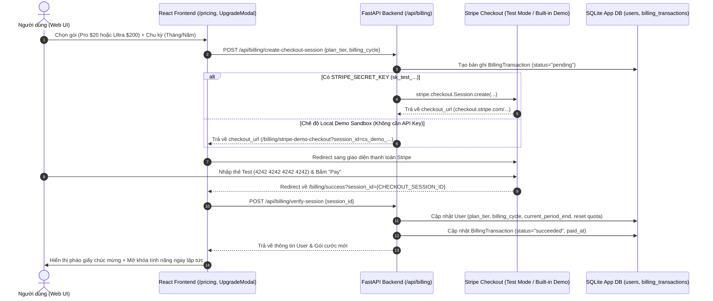

# Kế Hoạch Triển Khai Hệ Thống Premium Subscription & Stripe Billing — CITRA (`SourceLogic`)

> [!IMPORTANT]
> Tài liệu này thiết kế toàn diện mô hình thương mại hóa SaaS (**Freemium → Pro → Ultra**), chiến lược giá theo tháng/năm chuẩn tâm lý học Marketing, cơ chế kiểm soát hạn mức (**Quota & Feature Gating**), và luồng thanh toán **Stripe Demo** (hỗ trợ song song **Stripe Test Mode `sk_test_`** và **Interactive Stripe Sandbox** không cần cấu hình key ngoài khi chạy demo đồ án).

---

## 1. Chiến Lược Sản Phẩm & Ma Trận Gói Cước (SaaS Marketing Strategy)

### 1.1. Tâm lý học Định giá (Pricing Psychology) & Chu kỳ Thanh toán

Để tối ưu tỷ lệ chuyển đổi (Conversion Rate) theo chuẩn SaaS quốc tế:
1. **Chiến lược Chu kỳ Năm (Annual Billing — "Save 20% / 2 Months Free"):**
   - Khi người dùng chọn thanh toán theo năm, giảm **20%** so với trả từng tháng (tương đương **tặng hơn 2 tháng miễn phí**).
   - **Hiển thị giá theo tháng quy đổi** (ví dụ: hiển thị **`$16 / tháng`** thay vì `$192 / năm` ở cỡ chữ lớn, kèm dòng chữ nhỏ `Thanh toán $192 định kỳ hàng năm — Tiết kiệm $48`). Điều này giúp phá vỡ rào cản tâm lý mốc giá `$20` và `$200`.
2. **Hiệu ứng Chim mồi & Mỏ neo (Anchoring & Center-Stage Effect):**
   - Đặt gói **Pro ($20/tháng)** ở chính giữa bảng giá, nổi bật với viền `ring-2 ring-indigo-600`, nhãn **`PHỔ BIẾN NHẤT (MOST POPULAR)`**.
   - Gói **Ultra ($200/tháng)** đóng vai trò **Price Anchor (Mỏ neo giá cao)** cho nhóm Phòng thí nghiệm / Bộ môn / Hội đồng chấm luận án, giúp gói **Pro ($20 — chỉ bằng 1/10 gói Ultra)** trở thành lựa chọn "hời" và dễ ra quyết định nhất cho cá nhân.
3. **Điểm chạm Nâng cấp Mềm (Contextual Soft Paywalls):**
   - Không ẩn hoàn toàn các tính năng cao cấp khỏi giao diện Free User. Thay vào đó, giữ nguyên nút/tab kèm nhãn `PRO` và hiển thị **Blurred Preview + Upgrade Modal** khi người dùng nhấp vào (ví dụ: khi bấm xuất file Word/PDF hoặc mở tab *Document Inspector* / *Logic Trace*).

---

### 1.2. Bảng Phân Bổ Giá & Quyền Lợi Chi Tiết (3 Tiers)

| Hạng mục / Tính năng | **Basic** (Mặc định) | **Pro** ⭐ *Most Popular* | **Ultra** 🏛️ *Labs & Faculty* |
| :--- | :--- | :--- | :--- |
| **Đối tượng mục tiêu** | Sinh viên kiểm tra bài tập & tiểu luận ngắn | Nghiên cứu sinh, Cao học, Giảng viên cá nhân | Phòng thí nghiệm (Labs), Bộ môn, Hội đồng luận án |
| **Giá theo Tháng (Monthly)** | **$0** `/ tháng` | **$20** `/ tháng` | **$200** `/ tháng` |
| **Giá theo Năm (Annual -20%)** | **$0** `/ năm` | **$16** `/ tháng` *(Trả $192/năm — Tiết kiệm $48)* | **$160** `/ tháng` *(Trả $1,920/năm — Tiết kiệm $480)* |
| **Hạn mức tải tài liệu (Uploads)** | **3 tài liệu / tháng** | **50 tài liệu / tháng** | **Không giới hạn** *(Fair-use: 1,000 bài/tháng)* |
| **Dung lượng file PDF tối đa** | Tối đa **5 MB** / file | Tối đa **25 MB** / file | Tối đa **100 MB** / file |
| **Giới hạn số trang PDF** | Tối đa **15 trang** / bài | Tối đa **100 trang** / bài *(Luận văn ThS/ĐH)* | Tối đa **500 trang** / bài *(Luận án TS / Sách)* |
| **Số trích dẫn kiểm chứng / bài** | Tối đa **30 trích dẫn** đầu tiên | Tối đa **200 trích dẫn** / bài | **Không giới hạn** số lượng trích dẫn |
| **Tải lên hàng loạt (Batch Check)** | ❌ Không hỗ trợ *(Chỉ đơn file)* | ✅ Tối đa **10 PDFs / lần** | ✅ Tối đa **50 PDFs / lần** *(Luồng ưu tiên)* |
| **Nguồn đối chiếu Học thuật** | Tier 0 + Tier 1 cơ bản *(Local 127K DB, Crossref, OpenAlex)* | Full 7 nguồn học thuật *(+DBLP, arXiv, PubMed, OpenLibrary)* | Full 7 nguồn + **SerpAPI Google Scholar Fallback** + Active Link Check |
| **Deep Neural Evidence Layer** | Cơ bản *(Title/Author/Year matching)* | ✅ **Sentence-BERT Claim/Stance** + Đa ngôn ngữ VI↔EN | ✅ Full Deep Neural + Phân tích đa vị trí trích dẫn |
| **Chuyên trang Phân tích Sâu** | Chỉ xem Tổng quan CIS & Bảng Verdict | ✅ Mở khóa **Document Inspector, Logic Trace, Evidence Graph, Consistency** | ✅ Mở khóa toàn bộ + So sánh chéo cấp độ Lớp/Khoa |
| **Xuất Báo cáo (Export Report)** | Chỉ xem trực tuyến *(JSON)* | ✅ Xuất **PDF chuẩn học thuật, DOCX (Word), CSV, JSON** | ✅ Xuất **PDF, DOCX, CSV, JSON + Batch Class ZIP** |
| **Quản lý Lớp học (Classroom)** | Chỉ tham gia lớp (Student) | Quản lý tối đa **3 lớp** *(≤ 40 SV/lớp)* + Override Verdict | **Không giới hạn** lớp học & sinh viên + Full Audit Log |
| **Lưu trữ Lịch sử (Retention)** | Lưu trữ **7 ngày** | Lưu trữ **1 năm** | **Lưu trữ vĩnh viễn** + Hỗ trợ ưu tiên 24/7 |

---

## 2. Kiến Trúc Kỹ Thuật & Luồng Thanh Toán Stripe Demo



> [!TIP]
> **Cơ chế Dual-Mode Stripe Demo (Chống lỗi tuyệt đối khi Demo Đồ Án):**
> - **Chế độ 1 — Real Stripe Test Mode:** Nếu trong `.env` có `STRIPE_SECRET_KEY=sk_test_...`, backend gọi trực tiếp Stripe SDK tạo Hosted Checkout Session thật của Stripe.
> - **Chế độ 2 — Built-in Stripe Checkout Sandbox:** Nếu chạy máy local/Docker chấm đồ án mà không cấu hình key ngoài, hệ thống tự động chuyển hướng sang trang mô phỏng **Stripe Checkout UI (`/billing/demo-checkout`)** được thiết kế chuẩn giao diện Stripe với nút điền nhanh thẻ test `4242 •••• •••• 4242`, xử lý thanh toán và kích hoạt gói hoàn chỉnh 100%.

---

## 3. Thiết Kế Cơ Sở Dữ Liệu & Cấu Hình Backend

### 3.1. Mở rộng Model [`User`](file:///Users/iannwendy/Desktop/DATN/essay-integrity-checker/src/integrity_checker/db/models.py#L22-L60) & Bảng Giao Dịch Mới

Cập nhật trong [models.py](file:///Users/iannwendy/Desktop/DATN/essay-integrity-checker/src/integrity_checker/db/models.py) và thêm inline migration tự động trong [session.py](file:///Users/iannwendy/Desktop/DATN/essay-integrity-checker/src/integrity_checker/db/session.py#L76-L188):

1. **Các cột bổ sung vào bảng `users`:**
   - `plan_tier`: `String(20)`, mặc định `"basic"` (`"basic" | "pro" | "ultra"`). Tài khoản `admin` mặc định được cấp `"ultra"`.
   - `billing_cycle`: `String(20)`, nullable (`"monthly" | "annual" | None`).
   - `subscription_status`: `String(30)`, mặc định `"active"` (`"active" | "canceled" | "past_due"`).
   - `stripe_customer_id`: `String(120)`, nullable, indexed.
   - `stripe_subscription_id`: `String(120)`, nullable.
   - `current_period_start`: `DateTime`, nullable.
   - `current_period_end`: `DateTime`, nullable.
   - `cancel_at_period_end`: `Integer` (bool), mặc định `0`.
   - `monthly_uploads_used`: `Integer`, mặc định `0` (số tài liệu đã tải lên trong chu kỳ tháng hiện tại).
   - `quota_reset_at`: `DateTime`, nullable (thời điểm reset bộ đếm `monthly_uploads_used` về 0).

2. **Bảng mới `billing_transactions` (`BillingTransaction`):**
   - `id`: `Integer`, Primary Key.
   - `user_id`: `ForeignKey("users.id", ondelete="CASCADE")`, indexed.
   - `stripe_session_id`: `String(120)`, unique, indexed (`cs_test_...` hoặc `cs_demo_...`).
   - `plan_tier`: `String(20)` (`"pro" | "ultra"`).
   - `billing_cycle`: `String(20)` (`"monthly" | "annual"`).
   - `amount_usd`: `Float` (`20.0`, `192.0`, `200.0`, `1920.0`).
   - `currency`: `String(10)`, mặc định `"usd"`.
   - `status`: `String(30)` (`"pending" | "succeeded" | "canceled" | "failed"`).
   - `card_brand`: `String(20)`, mặc định `"visa"`.
   - `card_last4`: `String(4)`, mặc định `"4242"`.
   - `created_at`: `DateTime`.
   - `paid_at`: `DateTime`, nullable.

---

### 3.2. Module Chính Sách Hạn Mức (`src/integrity_checker/billing/plans.py`)

Tạo module tập trung định nghĩa toàn bộ thông số hạn mức của 3 gói để dùng chung cho cả API kiểm tra và trả về cho Frontend:

```python
# Mã giả minh họa cấu trúc PlanPolicy
PLAN_CATALOG = {
    "basic": {
        "name": "Basic",
        "monthly_price_usd": 0,
        "annual_price_usd": 0,
        "annual_monthly_equiv_usd": 0,
        "max_uploads_per_month": 3,
        "max_file_size_mb": 5,
        "max_pages_per_pdf": 15,
        "max_citations_per_essay": 30,
        "max_batch_files": 1,
        "allowed_export_formats": ["json"],
        "allow_deep_inspector": False,   # Document Inspector, Logic Trace, Orphan/Consistency
        "allow_serpapi_fallback": False,
        "max_classes": 0,
        "history_retention_days": 7,
    },
    "pro": {
        "name": "Pro",
        "badge": "MOST POPULAR",
        "monthly_price_usd": 20,
        "annual_price_usd": 192,          # $16/tháng * 12 (Tiết kiệm 20% = $48)
        "annual_monthly_equiv_usd": 16,
        "max_uploads_per_month": 50,
        "max_file_size_mb": 25,
        "max_pages_per_pdf": 100,
        "max_citations_per_essay": 200,
        "max_batch_files": 10,
        "allowed_export_formats": ["json", "csv", "pdf", "docx"],
        "allow_deep_inspector": True,
        "allow_serpapi_fallback": False,
        "max_classes": 3,
        "history_retention_days": 365,
    },
    "ultra": {
        "name": "Ultra",
        "badge": "INSTITUTION & LABS",
        "monthly_price_usd": 200,
        "annual_price_usd": 1920,         # $160/tháng * 12 (Tiết kiệm 20% = $480)
        "annual_monthly_equiv_usd": 160,
        "max_uploads_per_month": 1000,    # Unlimited (Fair-use)
        "max_file_size_mb": 100,
        "max_pages_per_pdf": 500,
        "max_citations_per_essay": 2000,
        "max_batch_files": 50,
        "allowed_export_formats": ["json", "csv", "pdf", "docx"],
        "allow_deep_inspector": True,
        "allow_serpapi_fallback": True,
        "max_classes": 999,
        "history_retention_days": 36500,
    },
}
```

---

### 3.3. Các Điểm Chặn Hạn Mức (Enforcement Hooks) Trên Backend

1. **Chặn tại Endpoint Upload Tài liệu ([`src/integrity_checker/api/routes/essays.py`](file:///Users/iannwendy/Desktop/DATN/essay-integrity-checker/src/integrity_checker/api/routes/essays.py#L240-L320)):**
   - **Bước 1 (Lazy Quota Reset):** Kiểm tra nếu `now >= user.quota_reset_at` (hoặc chưa khởi tạo), đặt lại `monthly_uploads_used = 0` và cộng thêm 30 ngày vào `quota_reset_at`. Nếu `current_period_end` của gói trả phí đã hết hạn mà `cancel_at_period_end == 1`, tự động hạ xuống `"basic"`.
   - **Bước 2 (Kiểm tra số lượt Upload tháng):** Nếu `user.monthly_uploads_used >= plan.max_uploads_per_month`, trả về `HTTP 402 Payment Required` với chi tiết:
     ```json
     {
       "detail": "Bạn đã sử dụng hết 3/3 lượt kiểm tra miễn phí trong tháng này. Nâng cấp lên gói Pro để kiểm tra 50 tài liệu/tháng.",
       "code": "MONTHLY_QUOTA_EXCEEDED",
       "current_tier": "basic",
       "required_tier": "pro",
       "used": 3,
       "limit": 3
     }
     ```
   - **Bước 3 (Kiểm tra dung lượng file PDF):** Truyền `max_bytes = plan.max_file_size_mb * 1024 * 1024` vào hàm [`_read_pdf_upload_bounded()`](file:///Users/iannwendy/Desktop/DATN/essay-integrity-checker/src/integrity_checker/api/routes/essays.py#L217-L233). Nếu vượt quá (ví dụ file 8MB trên gói Basic 5MB), trả về `HTTP 413` kèm `code: "FILE_SIZE_LIMIT_EXCEEDED"`.
   - **Bước 4 (Kiểm tra số trang PDF tức thì bằng PyMuPDF):** Mở buffer PDF bằng `fitz.open(stream=content, filetype="pdf")` để đếm `len(doc)`. Nếu `num_pages > plan.max_pages_per_pdf` (ví dụ bài 25 trang trên gói Basic giới hạn 15 trang), trả về `HTTP 402` kèm `code: "PAGE_LIMIT_EXCEEDED"`.
   - **Bước 5 (Tăng bộ đếm):** Sau khi tạo `EssayRecord` thành công, tăng `user.monthly_uploads_used += 1`.

2. **Chặn tại Pipeline Kiểm chứng (`_run_pipeline_task`):**
   - Với gói `basic`: Giới hạn danh sách trích dẫn đưa vào bước Retrieval tối đa `30` trích dẫn đầu tiên (gắn cờ thông báo nếu bài có nhiều hơn 30 trích dẫn) và tắt `serpapi` fallback.

3. **Chặn tại Endpoint Xuất Báo Cáo ([`src/integrity_checker/api/routes/report.py`](file:///Users/iannwendy/Desktop/DATN/essay-integrity-checker/src/integrity_checker/api/routes/report.py#L38-L76)):**
   - Khi gọi `GET /api/essays/{id}/report?format=pdf|docx|csv`, kiểm tra `format in plan.allowed_export_formats`. Nếu user đang ở gói `basic`, trả về `HTTP 402` (`code: "EXPORT_FORMAT_LOCKED"`, `required_tier: "pro"`).

4. **Endpoints Thanh toán mới (`src/integrity_checker/api/routes/billing.py`):**
   - `GET /api/billing/plans`: Trả về danh sách 3 gói cước, bảng giá tháng/năm, quyền lợi và trạng thái gói hiện tại của user.
   - `POST /api/billing/create-checkout-session`: Tạo phiên thanh toán Stripe (hoặc Demo Session) cho `plan_tier` (`pro` | `ultra`) và `billing_cycle` (`monthly` | `annual`).
   - `GET /api/billing/demo-session/{session_id}`: Trả về thông tin chi tiết đơn hàng cho màn hình giả lập Stripe Checkout.
   - `POST /api/billing/verify-session`: Xác nhận thanh toán thành công (từ Stripe Session ID hoặc Demo Session ID), nâng cấp `plan_tier` cho user, lưu hóa đơn vào `billing_transactions`.
   - `POST /api/billing/webhook`: Nhận sự kiện `checkout.session.completed` và `customer.subscription.deleted` từ Stripe.
   - `POST /api/billing/cancel`: Cho phép user hủy gia hạn tự động (`cancel_at_period_end = True`) hoặc chuyển đổi gói trong phần Cài đặt.
   - `GET /api/billing/transactions`: Lấy lịch sử thanh toán & hóa đơn của user.

---

## 4. Thiết Kế Giao Diện & Trải Nghiệm Người Dùng (Frontend UX/UI)

### 4.1. Các Trang & Component Mới / Cập Nhật

| Thành phần UI | Đường dẫn / File | Mô tả chức năng & Hiệu ứng Marketing |
| :--- | :--- | :--- |
| **1. Bảng Giá (Pricing Page & Section)** | `web/src/pages/PricingPage.tsx` & `LandingPage.tsx` | • Thanh chuyển đổi **Theo tháng / Theo năm (Tiết kiệm 20%)**.<br>• 3 Card gói cước: **Basic ($0)**, **Pro ($20/tháng — $16/tháng khi trả năm, viền sáng Indigo + badge Phổ Biến Nhất)**, **Ultra ($200/tháng — $160/tháng khi trả năm, phong cách Gold/Violet cao cấp)**.<br>• Bảng so sánh chi tiết tính năng (Feature Comparison Matrix) & FAQ thanh toán. |
| **2. Giao diện Thanh toán Stripe Demo** | `web/src/pages/StripeDemoCheckoutPage.tsx` (`/billing/demo-checkout`) | • Giao diện chuẩn **Stripe Hosted Checkout** (cột trái: tóm tắt đơn hàng CITRA Pro/Ultra, số tiền, chu kỳ; cột phải: form thẻ tín dụng Stripe).<br>• Nút **"Điền nhanh thẻ Test Visa 4242"** (1-click autofill `4242 4242 4242 4242`, ngày hết hạn, CVC) để demo mượt mà trong 3 giây. |
| **3. Trang Kết quả Thanh toán** | `web/src/pages/BillingSuccessPage.tsx` (`/billing/success`) | • Tự động gọi `verify-session`, làm mới `AuthContext`, hiển thị biên lai thanh toán, hạn mức mới và nút quay lại tải tài liệu ngay. |
| **4. Thanh Hạn mức Sidebar (Quota Meter)** | [`web/src/components/AppLayout.tsx`](file:///Users/iannwendy/Desktop/DATN/essay-integrity-checker/web/src/components/AppLayout.tsx) | • Đặt ở góc dưới Sidebar (trên khu vực Profile): Hiển thị Badge gói (`BASIC` / `PRO` / `ULTRA`), thanh tiến trình `Đã dùng 2/3 bài tháng này`, và nút CTA **"Nâng cấp Pro ⚡"** cho user gói Basic. |
| **5. Modal Nâng cấp Ngữ cảnh** | `web/src/components/UpgradeModal.tsx` | • Bật lên tự động khi: (1) Hết lượt upload tháng, (2) Chọn file PDF > 5MB hoặc > 15 trang ở gói Basic, (3) Bấm nút Xuất PDF/DOCX/CSV ở gói Basic, (4) Bấm vào tính năng Batch Upload. |
| **6. Khóa Mềm (Soft Paywall) trên Trang Báo Cáo** | [`EssayTabNav.tsx`](file:///Users/iannwendy/Desktop/DATN/essay-integrity-checker/web/src/pages/essay/EssayTabNav.tsx) & [`EssayActionBar.tsx`](file:///Users/iannwendy/Desktop/DATN/essay-integrity-checker/web/src/pages/essay/EssayActionBar.tsx) | • Hiển thị biểu tượng `PRO` nhỏ cạnh nút xuất **PDF / DOCX / CSV** và các tab nâng cao (**Logic Trace, Document Inspector, Consistency**) đối với user gói Basic. Khi bấm vào sẽ mở `UpgradeModal` thay vì báo lỗi thô. |
| **7. Quản lý Gói cước & Hóa đơn** | [`web/src/pages/SettingsPage.tsx`](file:///Users/iannwendy/Desktop/DATN/essay-integrity-checker/web/src/pages/SettingsPage.tsx) | • Thêm khu vực **Gói cước & Thanh toán (Subscription & Billing)**: Xem gói hiện tại, ngày gia hạn, lịch sử hóa đơn (`BillingTransaction`), nút nâng cấp hoặc hủy gia hạn. |
| **8. Đa ngôn ngữ (VI / EN)** | `web/src/i18n/locales/vi.json` & `en.json` | • Bổ sung toàn bộ từ khóa song ngữ Việt – Anh cho bảng giá, thông báo hạn mức, và cổng thanh toán Stripe. |

---

## 5. Lộ Trình Triển Khai Từng Bước (Implementation Phases)

### Phase 1: Database Schema, Cấu hình Gói cước & Quota Service (Backend)
- [ ] Tạo `src/integrity_checker/billing/__init__.py` và `src/integrity_checker/billing/plans.py` định nghĩa `PLAN_CATALOG` (Basic, Pro, Ultra) và helper kiểm tra quyền/hạn mức.
- [ ] Cập nhật [`src/integrity_checker/db/models.py`](file:///Users/iannwendy/Desktop/DATN/essay-integrity-checker/src/integrity_checker/db/models.py): Thêm các cột subscription/quota vào `User` và tạo model `BillingTransaction`.
- [ ] Cập nhật [`src/integrity_checker/db/session.py`](file:///Users/iannwendy/Desktop/DATN/essay-integrity-checker/src/integrity_checker/db/session.py): Bổ sung inline migration `ALTER TABLE users ADD COLUMN ...` cho các DB hiện hành và cấp mặc định gói `ultra` cho tài khoản `admin`.
- [ ] Cập nhật schema trả về của `/api/auth/me` và `/api/users/me` để gửi kèm thông tin `plan_tier`, `billing_cycle`, `subscription_status`, `quota` (`used`, `limit`, `max_file_size_mb`, `max_pages_per_pdf`, `reset_at`).

### Phase 2: Stripe Demo Billing API & Enforcement Hooks (Backend)
- [ ] Tạo `src/integrity_checker/api/routes/billing.py` và đăng ký vào [`src/integrity_checker/api/main.py`](file:///Users/iannwendy/Desktop/DATN/essay-integrity-checker/src/integrity_checker/api/main.py) dưới prefix `/api/billing`.
- [ ] Tích hợp kiểm tra hạn mức (số lượt tháng, dung lượng file theo gói, số trang PDF) vào [`src/integrity_checker/api/routes/essays.py`](file:///Users/iannwendy/Desktop/DATN/essay-integrity-checker/src/integrity_checker/api/routes/essays.py).
- [ ] Tích hợp kiểm tra quyền xuất báo cáo (`pdf`, `docx`, `csv`) vào [`src/integrity_checker/api/routes/report.py`](file:///Users/iannwendy/Desktop/DATN/essay-integrity-checker/src/integrity_checker/api/routes/report.py).

### Phase 3: Giao diện Bảng giá Chuẩn Marketing, Stripe Checkout & Paywall UI (Frontend)
- [ ] Mở rộng kiểu `User` và API client trong [`web/src/api/client.ts`](file:///Users/iannwendy/Desktop/DATN/essay-integrity-checker/web/src/api/client.ts) + [`web/src/hooks/useRole.ts`](file:///Users/iannwendy/Desktop/DATN/essay-integrity-checker/web/src/hooks/useRole.ts) để hỗ trợ kiểm tra gói cước (`planTier`, `isPro`, `isUltra`, `quota`).
- [ ] Xây dựng `PricingPage.tsx` (hỗ trợ cả truy cập công khai và trong AppLayout), `StripeDemoCheckoutPage.tsx`, `BillingSuccessPage.tsx`, và `UpgradeModal.tsx`.
- [ ] Bổ sung **Quota Usage Card** + **Plan Badge** vào Sidebar trong [`web/src/components/AppLayout.tsx`](file:///Users/iannwendy/Desktop/DATN/essay-integrity-checker/web/src/components/AppLayout.tsx).
- [ ] Tích hợp kiểm tra kích thước file & hiển thị banner hạn mức trực quan trên [`UploadPage.tsx`](file:///Users/iannwendy/Desktop/DATN/essay-integrity-checker/web/src/pages/UploadPage.tsx) và [`BatchUploadPage.tsx`](file:///Users/iannwendy/Desktop/DATN/essay-integrity-checker/web/src/pages/BatchUploadPage.tsx).
- [ ] Tích hợp Soft Paywall trên [`EssayActionBar.tsx`](file:///Users/iannwendy/Desktop/DATN/essay-integrity-checker/web/src/pages/essay/EssayActionBar.tsx) (nút Export) và [`SettingsPage.tsx`](file:///Users/iannwendy/Desktop/DATN/essay-integrity-checker/web/src/pages/SettingsPage.tsx) (quản lý gói & lịch sử hóa đơn).
- [ ] Bổ sung Pricing Section vào [`LandingPage.tsx`](file:///Users/iannwendy/Desktop/DATN/essay-integrity-checker/web/src/pages/LandingPage.tsx) để thu hút khách truy cập ngay từ trang chủ.

### Phase 4: Kiểm thử Tự động (Unit & Integration Tests)
- [ ] Viết unit/integration tests cho luồng kiểm tra hạn mức Basic/Pro/Ultra, tạo phiên thanh toán Stripe Demo, xác thực nâng cấp gói và hạ cấp gói.
- [ ] Chạy toàn bộ test suite Backend (`pytest`) và Frontend (`vitest` / `tsc -b`) đảm bảo 0 lỗi hồi quy.
